# IMPLEMENTATION_PLAN.md — Industrial Maintenance AI Agent

> **Documento de arquitectura y contrato de implementación para Claude Code.**
> Workshop: AI Architecture, AI Security & AI Governance · 3 sesiones × 4 horas · 80% práctica.
> **Caso:** diagnóstico asistido de bomba centrífuga P-204, usando únicamente datos sintéticos.

## 0. Instrucciones para Claude Code

Actúa como arquitecto de software y desarrollador senior de Python, AWS e IA agéntica. Construye este repositorio de forma **incremental, verificable y segura**. Este archivo es la fuente de requisitos; no presupongas que los componentes descritos ya están implementados.

**Reglas de ejecución:**
1. Antes de programar, inspecciona el repositorio y reporta qué existe y qué falta.
2. Implementa **una versión V01–V15 por vez**, sin adelantar componentes de sesiones posteriores salvo interfaces mínimas.
3. Para cada versión: explica el problema, propone el cambio, implementa código y pruebas, ejecuta verificaciones y documenta resultados en `labs/VXX/README.md`.
4. Conserva compatibilidad con versiones anteriores; no reescribas todo el proyecto.
5. Usa interfaces tipadas, Pydantic, inyección de dependencias y separación de responsabilidades.
6. Incluye modo `mock` reproducible sin llamadas reales a OpenAI/AWS, y modo real mediante configuración.
7. Nunca ejecutes acciones físicas sobre equipos industriales; sensores, CMMS y notificaciones serán simulados por defecto.
8. No almacenes secretos en código, `.env` versionados, trazas ni estado Terraform. Usa variables de entorno y Secrets Manager en AWS.
9. No despliegues ni ejecutes `terraform apply/destroy` sin confirmación explícita del operador.
10. No declares que una versión está completa hasta ejecutar sus pruebas de aceptación; si no puedes ejecutarlas, explica el bloqueo.
11. Usa diagramas Mermaid en documentación; evita CSS incrustado, HTML de diagramas y formatos propietarios.
12. En cada entrega incluye archivos modificados, comandos para probar, riesgos y criterios pendientes.

**Primer paso solicitado a Claude:** implementar únicamente V01 y preparar scaffolding, datos sintéticos, pruebas y README. Esperar aprobación antes de V02.

## 1. Objetivos y alcance

El agente debe: consultar historial de fallas con RAG; consultar equipos/sensores mediante MCP; formular hipótesis con LangGraph; persistir incidentes en Supabase; aplicar autenticación y autorización; solicitar aprobación para acciones sensibles; registrar auditoría; medir calidad; desplegarse mediante Docker, GitHub Actions y ECR en Lambda o EC2.

**No alcance:** control de PLC/SCADA, modificación de setpoints, detener maquinaria, conectarse a sistemas industriales reales, ejecución de órdenes reales sin habilitación y aprobación específica.

### Datos sintéticos del escenario

| Campo | Valor de demostración |
|---|---|
| Equipo | P-204 |
| Tipo | Bomba centrífuga |
| Planta | PLANT-A |
| Temperatura rodamiento | 86 °C |
| Vibración | 8.4 mm/s |
| Presión descarga | 2.8 bar |
| Incidente | INC-204 |

Los valores son ficticios; **no constituyen límites de seguridad industrial**. La respuesta debe distinguir observaciones, hipótesis, evidencia y acciones sugeridas; no afirmar causa raíz sin evidencia suficiente.

## 2. Stack y decisiones

| Capa | Selección |
|---|---|
| Repositorio | GitHub |
| API | FastAPI + Pydantic |
| Runtime principal | AWS Lambda (contenedor) + API Gateway |
| Runtime alternativo | Amazon EC2 + Docker |
| Modelo | OpenAI API, con adaptador mock |
| Orquestación | LangGraph |
| RAG y adaptadores | LangChain |
| Memoria | Supabase PostgreSQL |
| Historial semántico | Supabase pgvector |
| Herramientas | Servidor MCP de mantenimiento y cliente MCP |
| Autorización | JWT validado, RBAC/ABAC, políticas backend; AWS IAM para recursos AWS |
| Secretos | AWS Secrets Manager |
| Observabilidad | CloudWatch + OpenTelemetry cuando esté configurado |
| Infraestructura | Terraform |
| CI/CD | GitHub Actions |
| Imagen | Docker + Amazon ECR |

**API key de API Gateway:** sirve para identificación/consumo de clientes y usage plans; **no sustituye autenticación de usuarios**. Para el laboratorio usar JWT validado con issuer/audience/firmas configurables y políticas por planta/equipo.

**Lambda y EC2:** reutilizan la lógica en `app/`; solo cambian adaptadores de entrada, empaquetado y configuración de ejecución. API Gateway debe tener rutas explícitas; no detecta automáticamente consultas largas.

## 3. Arquitectura objetivo

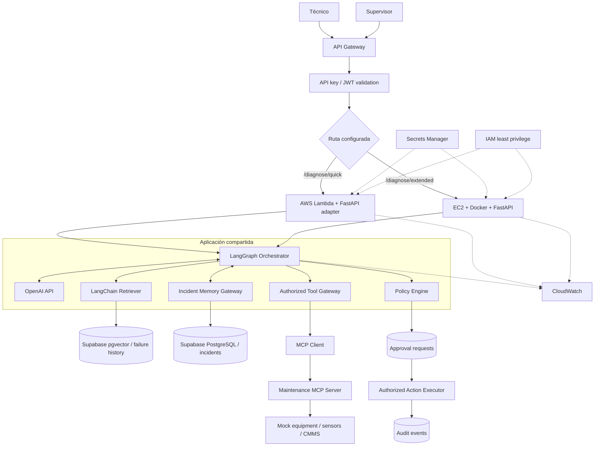

**Importante:** el executor solo actúa después de verificar identidad, alcance, política, aprobación cuando aplique e idempotencia. Las conexiones hacia MCP no otorgan permisos por sí solas.

## 4. Arquitectura A vs. B: justificación

| Decisión | Lambda | EC2 |
|---|---|---|
| Tráfico irregular y solicitudes breves | Preferida | Posible, pero capacidad activa |
| Ejecución individual >15 minutos | No | Sí |
| Workflows largos asíncronos | SQS/Step Functions + estado persistido | Workers persistentes posibles |
| Servidor MCP remoto persistente | Requiere adaptación de transporte/sesión | Conveniente |
| Control SO y procesos de larga vida | Limitado | Mayor |
| Escalado | Gestionado, con cuotas | Configurar ASG/balanceo si se requiere |
| Mantenimiento de infraestructura | Menor | Mayor |
| Costos | Por invocación/duración | Instancia y recursos aprovisionados |

**Decisión para workshop:** Lambda es el despliegue principal para consultas cortas; EC2 demuestra el mismo backend con un servicio persistente (p. ej., servidor MCP remoto o procesamiento prolongado). No ejecutar dos copias del orquestador para una misma solicitud. En Lambda, los trabajos que esperan aprobación se persisten y reanudan, no mantienen una invocación abierta.

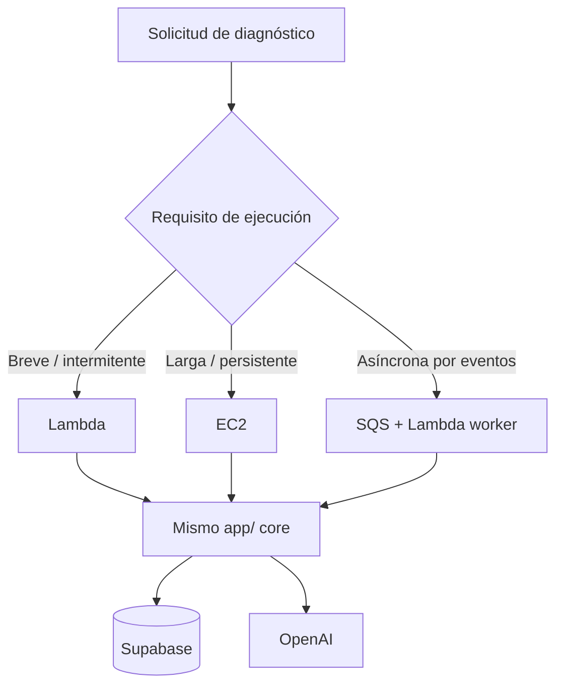

## 5. Sesión 1 — AI Architecture (240 min)

**Distribución:** V01 35 min · V02 45 min · V03 45 min · V04 50 min · V05 45 min · cierre 20 min.

### V01 — FastAPI + OpenAI (35 min)

**Problema:** se necesita responder preguntas sobre incidentes. **Construir:** `POST /diagnose` con entrada/salida Pydantic, proveedor OpenAI intercambiable por mock, manejo de errores.

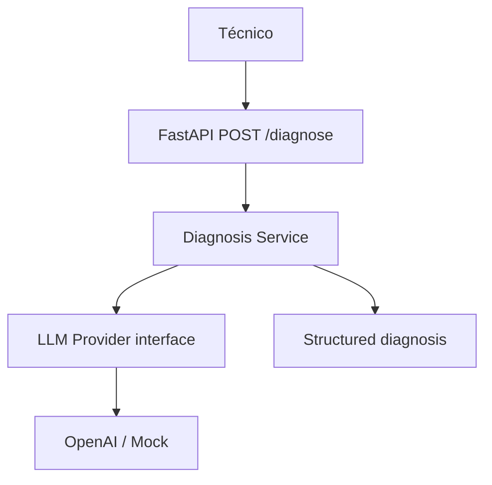

**Aceptación:** endpoint devuelve respuesta estructurada, test con proveedor mock, no secretos hardcodeados.

### V02 — RAG con Supabase (45 min)

**Problema:** el LLM carece de evidencia histórica. **Construir:** ingesta de fallas sintéticas, embeddings, `pgvector`, retriever LangChain y referencias de origen.

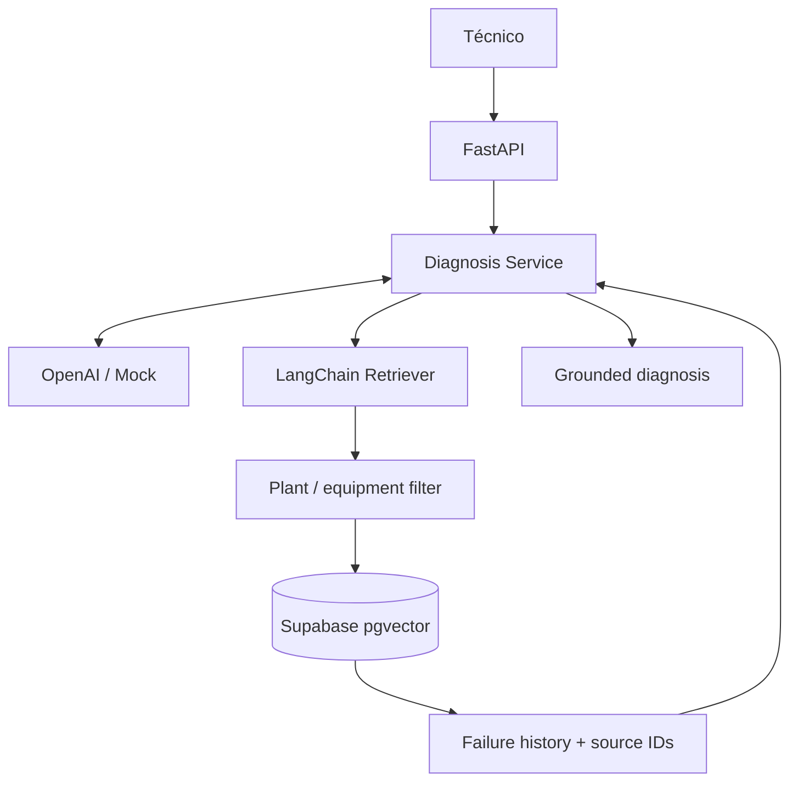

**Aceptación:** recupera fallas relevantes, conserva `source_id`, filtra por equipo/planta, no inventa fuentes.

### V03 — MCP tools (45 min)

**Problema:** RAG no da mediciones actuales. **Construir:** servidor MCP con `get_equipment_info`, `get_sensor_readings`, `get_failure_history`; cliente MCP y Tool Gateway con contratos tipados.

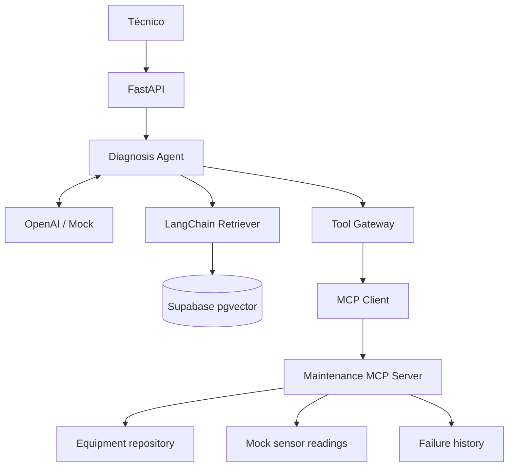

**Aceptación:** descubrimiento de herramientas, validación de argumentos, resultados tipados y rechazo de herramienta inexistente.

### V04 — LangGraph + memoria (50 min)

**Problema:** diagnóstico iterativo y continuidad entre solicitudes. **Construir:** grafo explícito, `max_steps`, nodos de razonamiento/herramientas, persistencia en Supabase, separación de hechos e hipótesis.

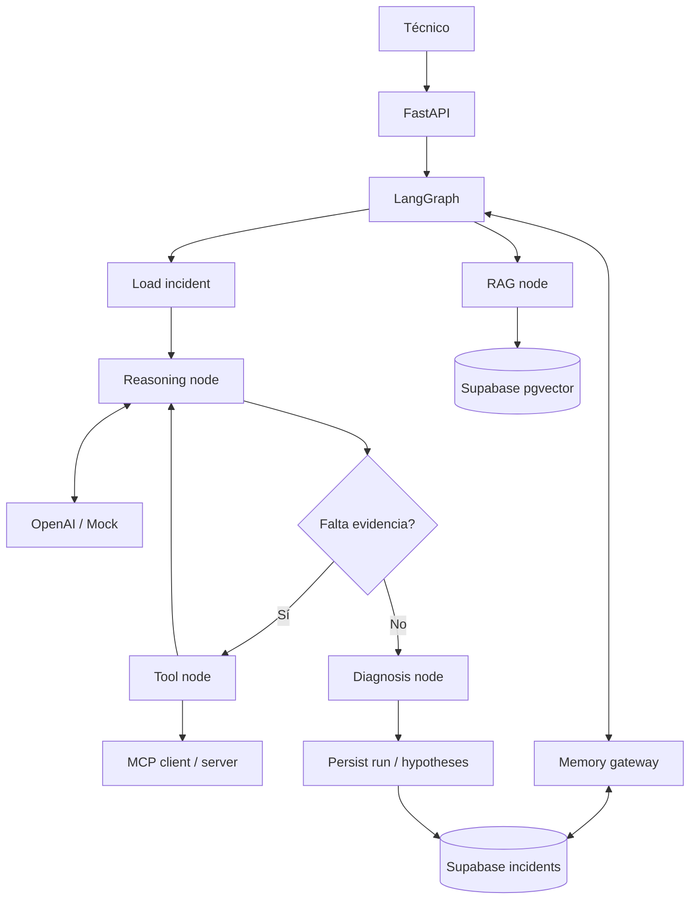

**Aceptación:** reanuda `INC-204`, guarda evidencia y estado, limita iteraciones y no confunde hipótesis con hechos.

### V05 — Lambda vs. EC2 (45 min)

**Problema:** decidir dónde desplegar el mismo runtime. **Construir:** Docker, handler Mangum para Lambda, arranque Uvicorn para EC2, rutas comparativas, CloudWatch básico.

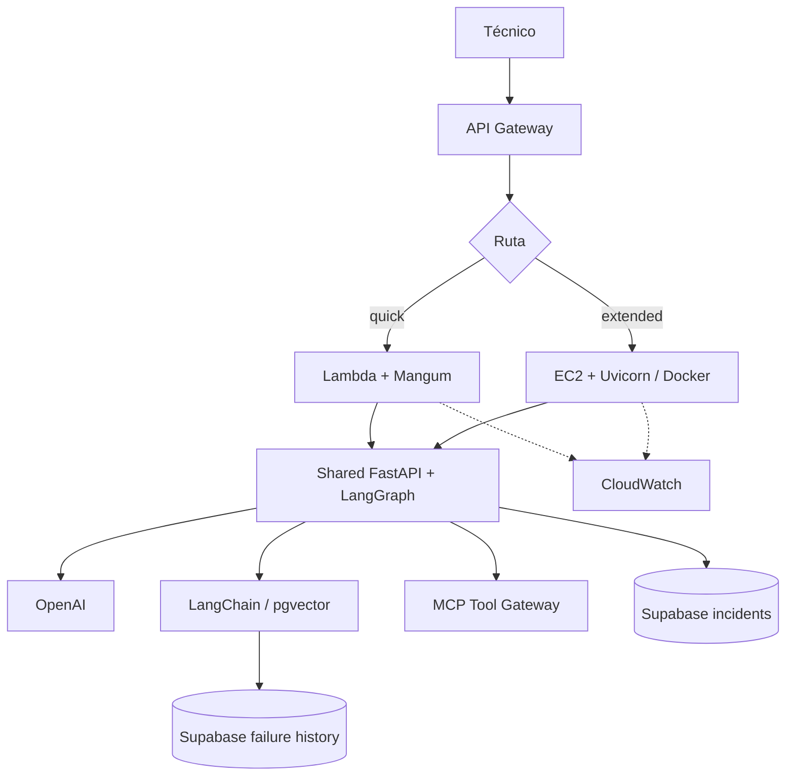

**Aceptación:** mismo test de diagnóstico en ambos runtimes, latencias registradas, comparación escrita de costos y limitaciones. Infraestructura ya preparada por instructor.

## 6. Sesión 2 — AI Security (240 min)

**Distribución:** V06 45 min · V07 50 min · V08 45 min · V09 50 min · V10 30 min · cierre 20 min.

### V06 — Trust boundaries / prompt injection (45 min)

**Problema:** el historial recuperado puede contener instrucciones hostiles. **Construir:** separación de contexto no confiable, referencias, validación de tool calls, tests adversariales.

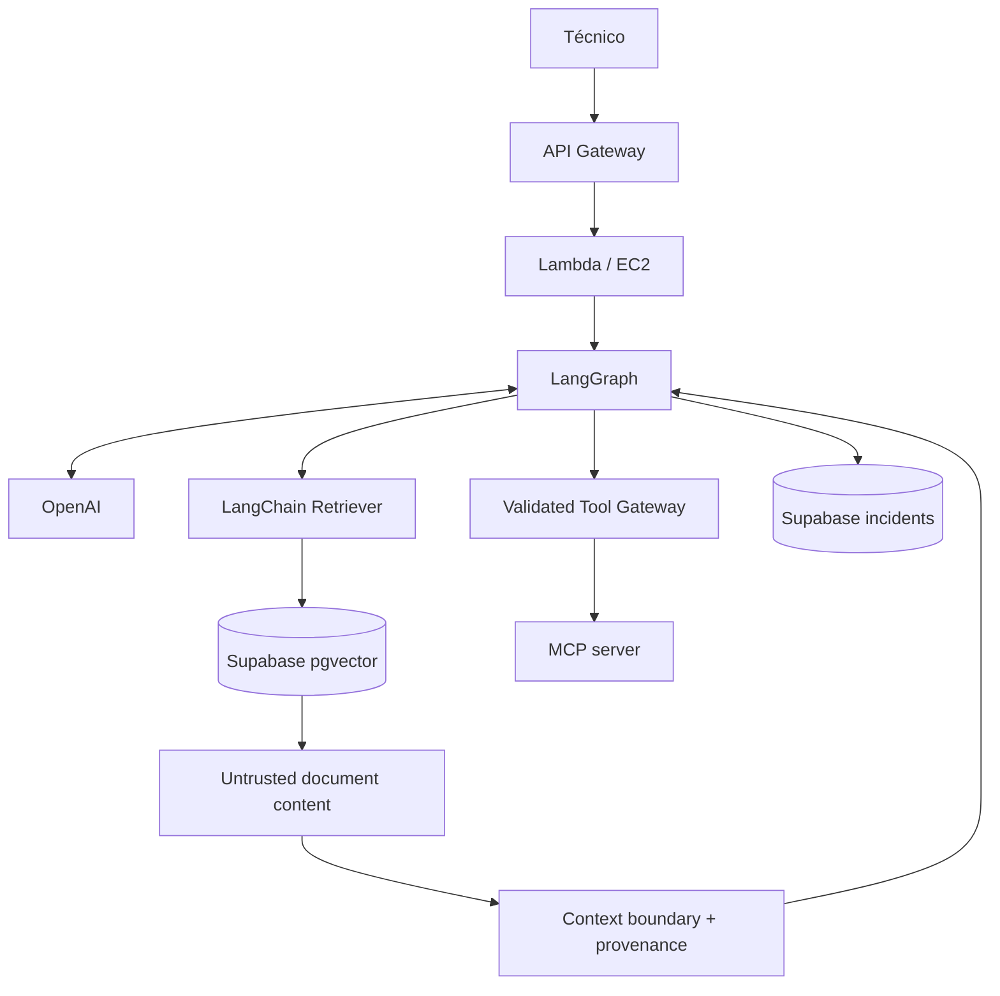

**Aceptación:** texto malicioso en documento no provoca exfiltración ni acciones no autorizadas. La defensa no depende exclusivamente de un prompt.

### V07 — JWT + RBAC/ABAC (50 min)

**Problema:** aislamiento entre plantas y equipos. **Construir:** JWT verificado, permisos por rol, planta, equipo e incidente; filtros en RAG y memoria.

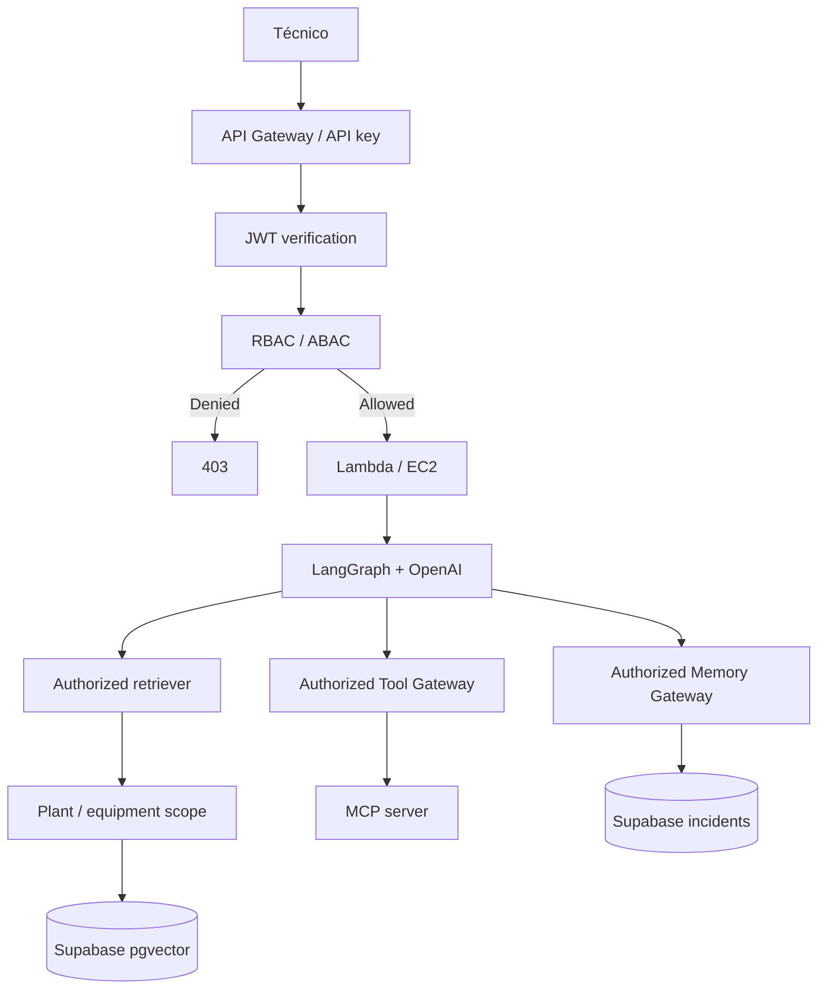

**Aceptación:** usuario PLANT-A no puede leer PLANT-B mediante endpoint, RAG, memoria ni MCP. IAM por sí solo no protege filas Supabase.

### V08 — Secrets Manager + secure MCP (45 min)

**Problema:** credenciales expuestas y permisos excesivos. **Construir:** IAM mínimo para Lambda/EC2, secretos recuperados en runtime, allowlist de herramientas y autorización también en servidor MCP.

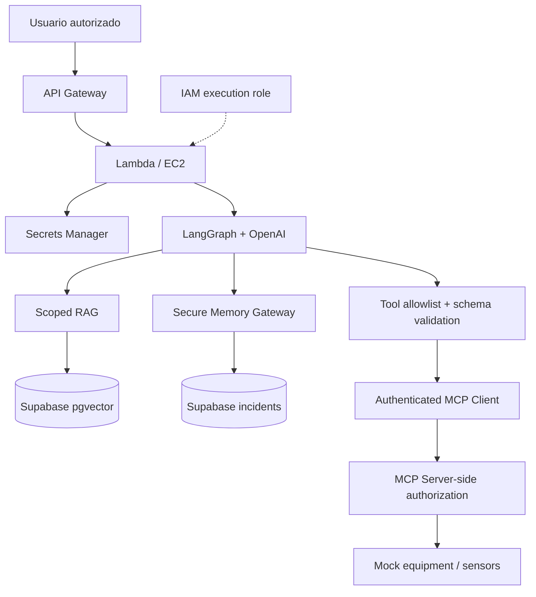

**Aceptación:** ninguna credencial en repo/logs, rechazo de herramienta no autorizada, políticas IAM mínimas documentadas.

### V09 — Secure memory + approved actions (50 min)

**Problema:** evitar contaminación de memoria y escrituras sin aprobación. **Construir:** validación de escrituras, Action Gateway, políticas deterministas, aprobación humana, executor idempotente.

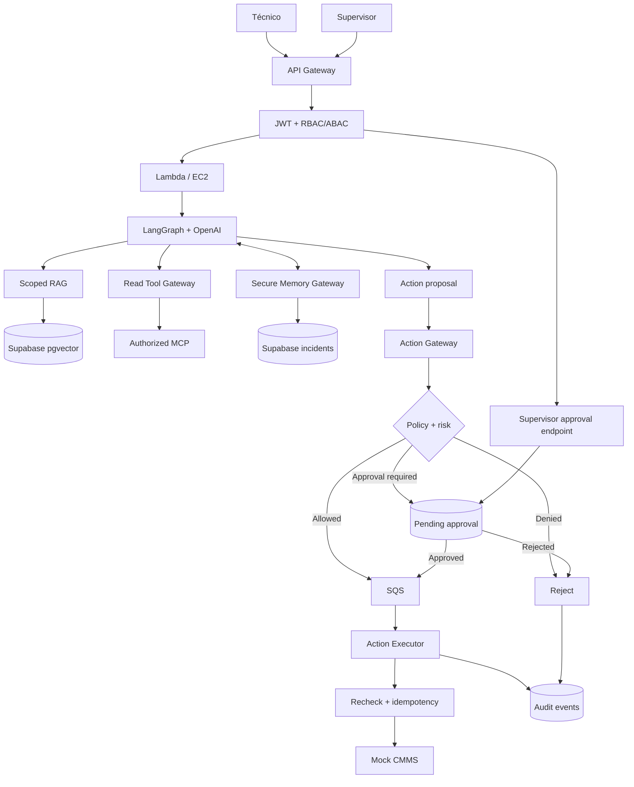

**Aceptación:** una orden de trabajo no se publica sin aprobación válida; reintentos no duplican acciones; escritura cruzada de incidentes bloqueada.

### V10 — Security CI (30 min)

**Problema:** una regresión puede reabrir vulnerabilidades. **Construir:** pytest para inyección, aislamiento, MCP y aprobaciones, ejecutado en GitHub Actions.

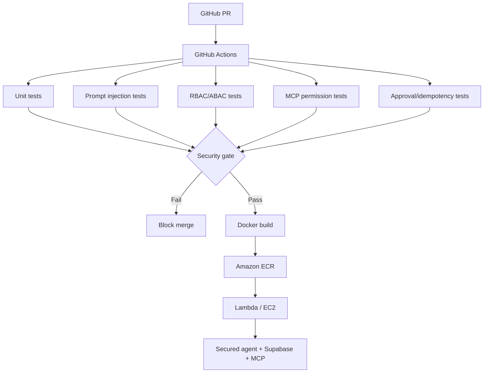

**Aceptación:** introducir fallo de aislamiento hace fallar CI; reparación vuelve a pasar.

## 7. Sesión 3 — AI Governance (240 min)

**Distribución:** V11 45 min · V12 50 min · V13 45 min · V14 50 min · V15 30 min · cierre 20 min.

### V11 — Risk policy and HITL (45 min)

**Problema:** definir autonomía permitida. **Construir:** registro de políticas versionadas, clasificación de riesgo y decision records.

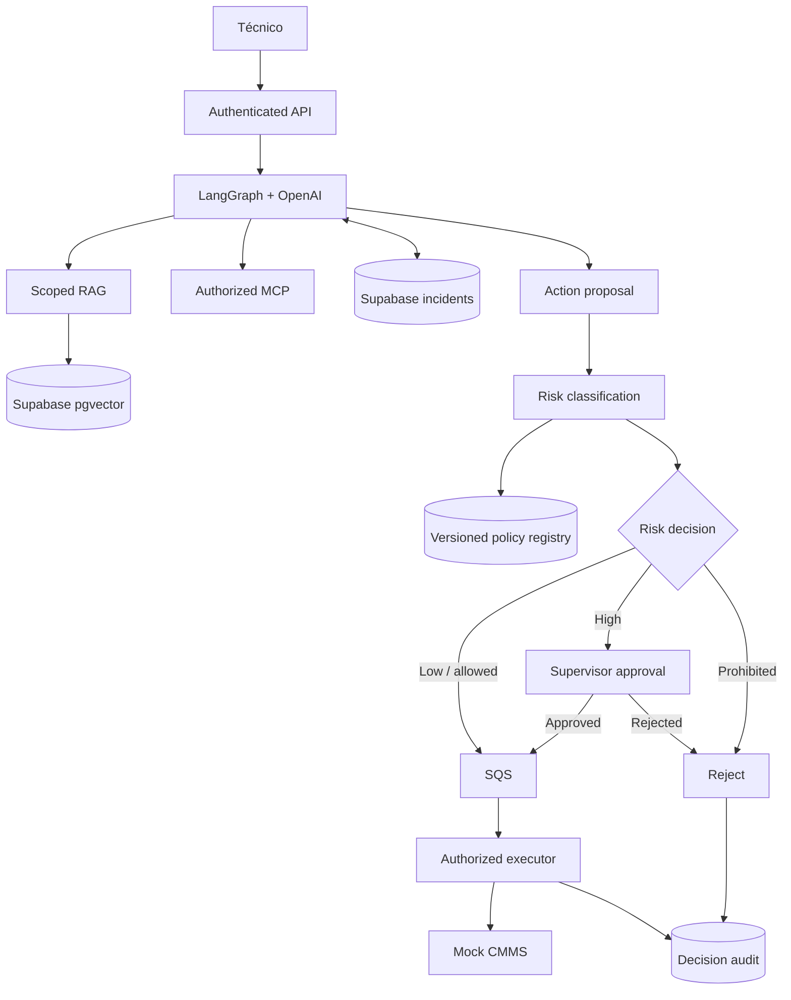

**Aceptación:** consultas permitidas; borradores permitidos; publicación requiere aprobación; control de PLC siempre prohibido.

### V12 — Golden/adversarial evaluation (50 min)

**Problema:** medir calidad y seguridad antes de liberar. **Construir:** evaluador determinista, golden dataset, conjunto adversarial, scorecard; LLM-as-judge opcional y no único criterio.

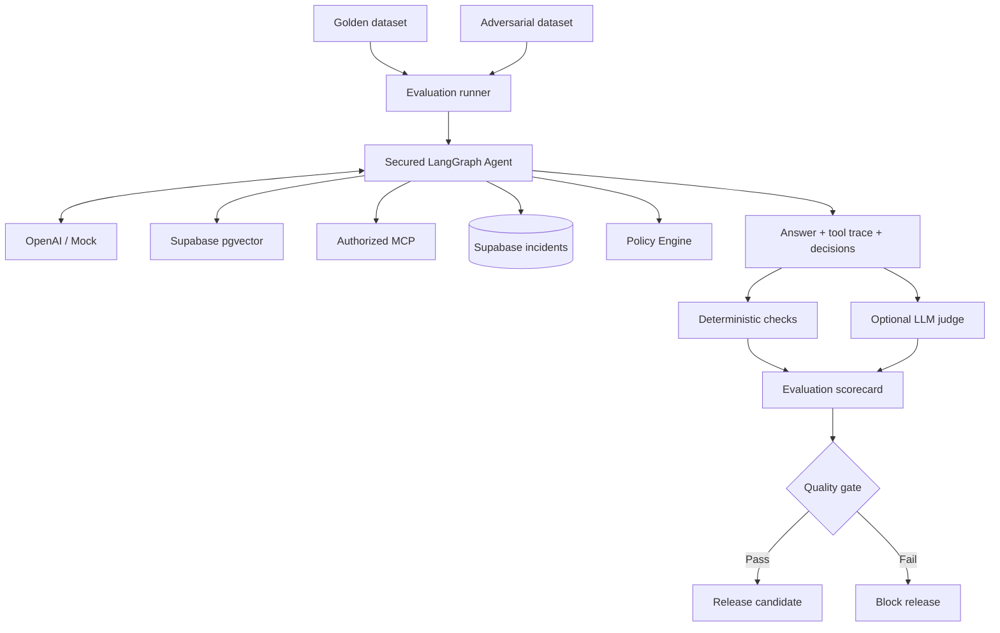

**Aceptación:** resultados reproducibles con mocks; métricas para citas, herramientas, autorización, latencia y costo estimado.

### V13 — Observability and audit (45 min)

**Problema:** reconstruir una ejecución y diagnosticar latencia. **Construir:** `trace_id`, `incident_id`, `run_id`, logs estructurados, métricas y trazas configuradas, auditoría separada.

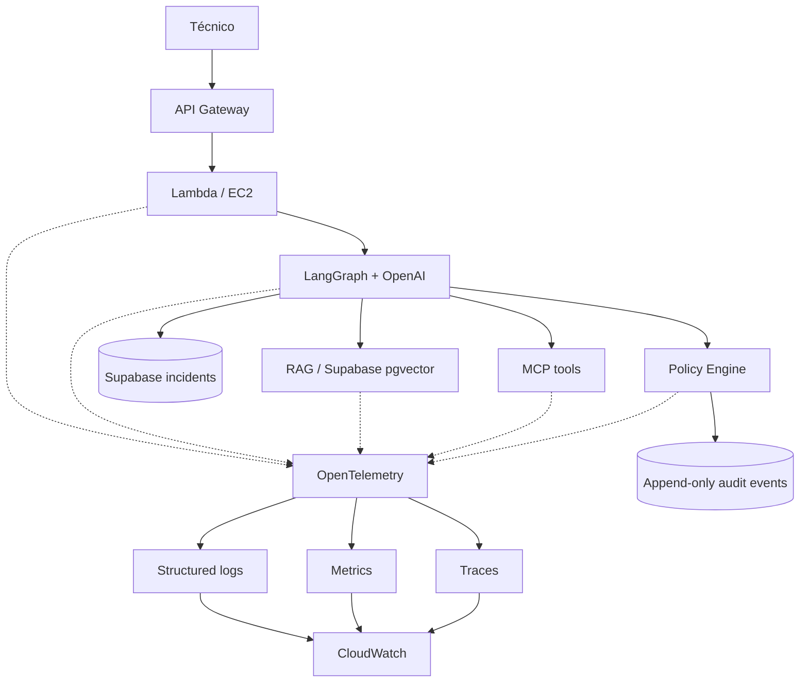

**Aceptación:** identificar latencia por nodo, correlacionar incidente y ejecución, redactar secretos/PII, registrar decisiones de autorización.

### V14 — Terraform + CI/CD + Docker + ECR (50 min)

**Problema:** desplegar cambios con control de calidad y rollback. **Construir:** Terraform para infraestructura, Actions para pruebas y releases, Docker para ambos runtimes, ECR para imágenes.

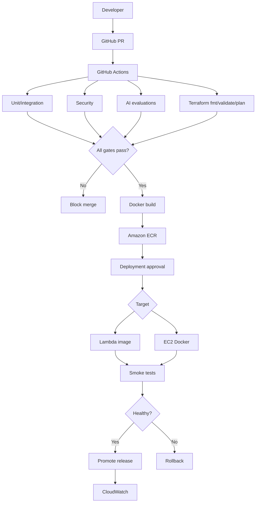

**Aceptación:** CI bloquea fallos; deploy con digest/version inmutable; smoke tests; rollback documentado. Terraform administra infraestructura y el pipeline administra releases sin drift no controlado.

### V15 — End-to-end P-204 (30 min)

**Problema:** demostrar la integración y los controles. **Construir:** escenario completo con incidente, evidencia, hipótesis, propuesta de orden y aprobación simulada.

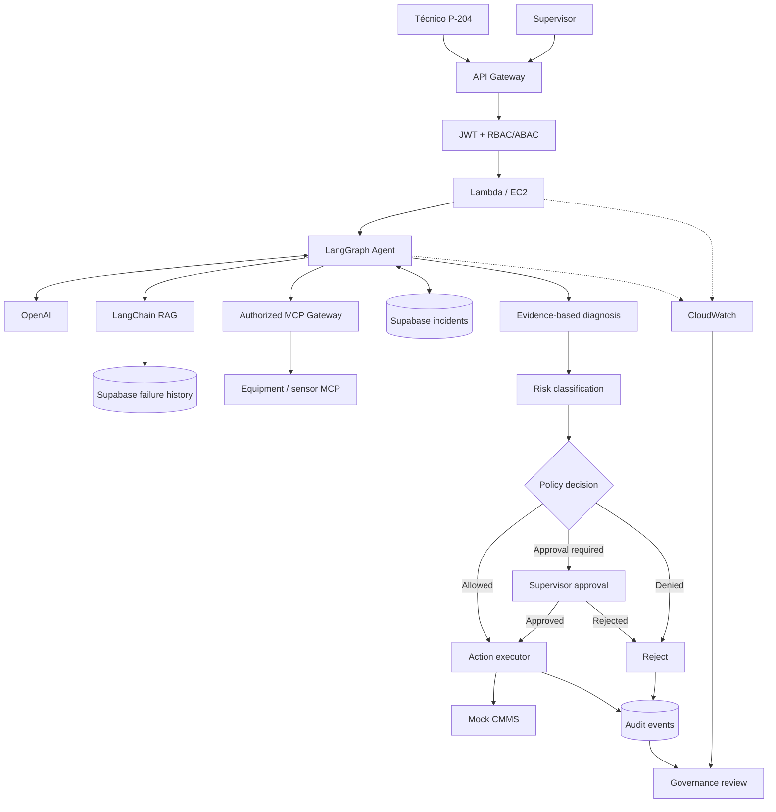

**Aceptación:** flujo de punta a punta, evidencia citada, no ejecución de acciones prohibidas, aprobación verificable, trazabilidad completa.

## 8. Contratos de API

Implementar progresivamente:

```text
GET  /health
POST /diagnose
POST /incidents
GET  /incidents/{incident_id}
POST /incidents/{incident_id}/diagnose
GET  /runs/{run_id}
POST /approvals/{approval_id}/approve
POST /approvals/{approval_id}/reject
GET  /incidents/{incident_id}/audit
```

**Request de diagnóstico (ejemplo):**

```json
{
  "incident_id": "INC-204",
  "equipment_id": "P-204",
  "plant_id": "PLANT-A",
  "symptoms": ["high_vibration", "high_bearing_temperature", "low_discharge_pressure"],
  "message": "Diagnostica la falla y recomienda verificaciones"
}
```

**Respuesta mínima:** `incident_id`, `run_id`, `status`, `observations`, `hypotheses`, `recommended_checks`, `citations`, `proposed_actions`, `trace_id`. Nunca incluir razonamiento interno privado del modelo; registrar solo decisiones y evidencia aptas para auditoría.

## 9. Esquema de datos Supabase

Tablas mínimas: `plants`, `equipment`, `failure_history`, `failure_history_chunks` (con `embedding`), `incidents`, `observations`, `hypotheses`, `agent_runs`, `action_requests`, `approvals`, `audit_events`, `policy_versions`. Usar UUID internos, códigos de negocio legibles, claves foráneas, índices por `plant_id`/`equipment_id`, timestamps y `created_by`.

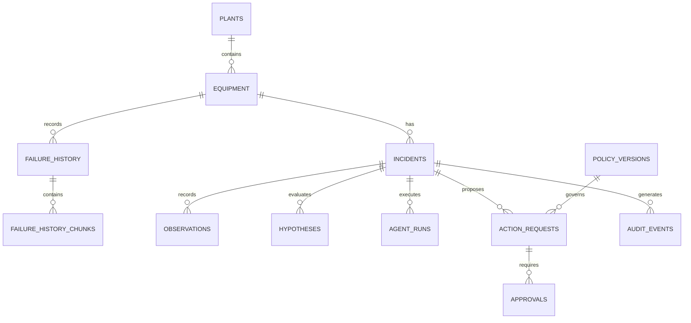

**Seguridad:** RLS donde corresponda; si el backend usa credenciales privilegiadas que omiten RLS, el backend debe verificar aislamiento en cada operación. Para Lambda, usar pooler/conexiones compatibles con cargas serverless y limitar concurrencia.

## 10. Dataset sintético requerido

Generar seeds deterministas y documentados, sin información real de clientes:

- 3 plantas: PLANT-A, PLANT-B, PLANT-C.
- 5 equipos, incluyendo P-204, con modelos, criticidad, ubicación y mantenimiento programado.
- 30 fallas históricas con causa confirmada, síntomas, acciones, tiempos y referencias.
- 20 lecturas de sensores con timestamps, unidades, calidad y equipo asociado.
- 5 manuales técnicos sintéticos con secciones identificables.
- 10 procedimientos de inspección y escalamiento.
- 25 casos golden: positivos, ambiguos, sin evidencia y autorización denegada.
- 10 casos adversariales: prompt injection, exfiltración, acceso cruzado, MCP no permitido, replay de aprobación, duplicación de acción.
- 3 perfiles: technician, supervisor, administrator; permisos por planta.

**Regla:** no fabricar un diagnóstico concluyente cuando falte evidencia; generar casos donde la respuesta correcta sea pedir una medición adicional.

## 11. Estructura objetivo del repositorio

```text
industrial-maintenance-ai/
├── README.md
├── IMPLEMENTATION_PLAN.md
├── pyproject.toml
├── .env.example
├── .gitignore
├── Dockerfile.lambda
├── Dockerfile.ec2
├── docker-compose.yml
├── app/
│   ├── api/{main.py,routes/}
│   ├── agents/{graph.py,state.py,nodes.py}
│   ├── llm/{base.py,openai_provider.py,mock_provider.py}
│   ├── retrieval/{ingest.py,retriever.py}
│   ├── mcp/{client.py,server.py,tool_gateway.py}
│   ├── repositories/{equipment.py,incidents.py,history.py}
│   ├── memory/{gateway.py}
│   ├── security/{authentication.py,authorization.py,secrets.py}
│   ├── governance/{policies.py,approvals.py,audit.py}
│   ├── actions/{gateway.py,executor.py}
│   └── observability/{telemetry.py}
├── handlers/{lambda_api.py}
├── data/{equipment/,manuals/,procedures/,history/,sensors/,evaluations/,attacks/}
├── supabase/{migrations/,seed.sql}
├── infrastructure/terraform/{bootstrap/,modules/,environments/dev/,environments/workshop/}
├── .github/workflows/{ci.yml,deploy.yml}
├── tests/{unit/,integration/,security/,evaluation/}
├── labs/{V01/,V02/,V03/,V04/,V05/,V06/,V07/,V08/,V09/,V10/,V11/,V12/,V13/,V14/,V15/}
└── docs/{architecture/,adr/,threat-model/,governance/}
```

Las carpetas del árbol son **objetivo**, no deben generarse como módulos vacíos innecesarios. Mantener importaciones válidas y estructura Python real.

## 12. Terraform y deployment

- Terraform: IAM mínimo, API Gateway, Lambda, ECR, SQS/DLQ si aplica, Secrets Manager (metadatos, no valores), CloudWatch y recursos EC2 de demo.
- Bootstrap separado para backend remoto S3, cifrado, versionado y locking soportado.
- GitHub Actions: OIDC a AWS; sin access keys estáticas; `terraform fmt`, `validate`, `plan` en PR; `apply` solo con aprobación.
- Build Docker reproducible y escaneo básico; publicar imagen en ECR y desplegar por digest.
- Lambda requiere imagen en **ECR**, no en GHCR. GHCR es opcional para distribución, no es requisito de este plan.
- Despliegue EC2: Docker con health checks; documentar actualización y rollback.
- CloudWatch: logs estructurados, métricas de errores/latencia, alarmas y trazas solo cuando exista exportador configurado.
- El CI/CD de aplicación no debe crear drift en atributos controlados por Terraform; definir ownership explícito de la versión de imagen.

## 13. Criterios globales de aceptación

1. `pytest` ejecuta tests unitarios sin red en modo mock.
2. Una consulta a P-204 produce respuesta estructurada y citas de historial.
3. El agente utiliza MCP para obtener datos simulados y valida argumentos.
4. El estado del incidente persiste y se reanuda.
5. Un usuario de PLANT-A no puede acceder a incidentes de PLANT-B por ninguna ruta.
6. Un prompt injection en historial no provoca acción no autorizada.
7. Una orden sensible requiere aprobación y no se duplica por reintentos.
8. Los cambios de políticas generan decision records auditables.
9. El pipeline bloquea regresiones de seguridad y calidad.
10. Lambda y EC2 ejecutan el mismo núcleo de aplicación con pruebas comparables.
11. Se pueden rastrear diagnósticos por `incident_id`, `run_id` y `trace_id`.
12. Los comandos de setup, seed, test, build y deploy están documentados.

## 14. Flujo de trabajo de Claude Code

Para cada versión VXX:

```text
1. Leer IMPLEMENTATION_PLAN.md y estado actual del repo.
2. Describir problema y arquitectura antes/después.
3. Listar archivos a crear/modificar.
4. Implementar mínimo cambio viable con tipos y validación.
5. Crear tests de aceptación y casos negativos.
6. Ejecutar lint/tests y corregir fallos.
7. Actualizar labs/VXX/README.md y diagrama Mermaid.
8. Presentar resumen, comandos y evidencia.
9. Esperar aprobación para pasar a VXX+1.
```

**Prompt de arranque recomendado:**

> Lee `IMPLEMENTATION_PLAN.md`. Inspecciona el repositorio y crea un plan corto para V01. Implementa únicamente el scaffolding mínimo, el proveedor mock y OpenAI, `POST /diagnose`, modelos Pydantic, `.env.example`, tests unitarios y README. No despliegues recursos AWS ni implementes V02–V15 todavía. Ejecuta las pruebas y reporta resultados y próximos pasos.

---

**Fin del documento.**
