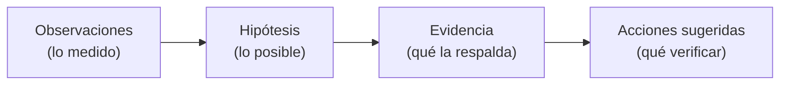

# 02 · Objetivos y alcance

## Objetivos: qué debe poder hacer el agente

| Capacidad | En palabras simples | Se construye en |
|---|---|---|
| Consultar historial de fallas con **RAG** | "¿Hemos visto algo así antes?" | V02 |
| Consultar equipos y sensores vía **MCP** | "¿Qué miden los sensores *ahora*?" | V03 |
| Formular hipótesis con **LangGraph** | "Podría ser desalineación porque…" | V04 |
| Persistir incidentes en **Supabase** | "Retomo el caso mañana" | V04 |
| **Autenticación y autorización** | "¿Quién eres y qué puedes ver?" | V07 |
| Pedir **aprobación** en acciones sensibles | "Un supervisor debe aprobar la orden" | V09, V11 |
| Registrar **auditoría** | "Quedó constancia de todo" | V13 |
| Medir **calidad** | "¿Responde bien y de forma segura?" | V12 |
| **Desplegar** con Docker, Actions, ECR en Lambda o EC2 | "Se publica de forma repetible" | V05, V14 |

## Fuera de alcance (importante)

El sistema **nunca** debe:

- Controlar PLC/SCADA.
- Modificar setpoints.
- Detener maquinaria.
- Conectarse a sistemas industriales reales.
- Ejecutar órdenes reales sin habilitación y aprobación específica.

> Es un **asistente de diagnóstico**, no un sistema de control. Puede *sugerir* y *proponer*; no *operar* equipos.

## Datos sintéticos del escenario

| Campo | Valor |
|---|---|
| Equipo | P-204 |
| Tipo | Bomba centrífuga |
| Planta | PLANT-A |
| Temperatura de rodamiento | 86 °C |
| Vibración | 8.4 mm/s |
| Presión de descarga | 2.8 bar |
| Incidente | INC-204 |

⚠️ **Los valores son ficticios** y no son límites de seguridad industrial.

## Cómo debe responder el agente

La respuesta debe separar claramente cuatro cosas:

| Concepto | Ejemplo |
|---|---|
| **Observación** | "Vibración 8.4 mm/s, rodamiento 86 °C." |
| **Hipótesis** | "Posible desgaste de rodamiento." |
| **Evidencia** | "Falla FH-012 tuvo síntomas similares (fuente citada)." |
| **Acción sugerida** | "Medir de nuevo la vibración en el lado acople." |

**Regla clave:** no afirmar una causa raíz sin evidencia suficiente. Si falta información, la respuesta correcta es **pedir una medición adicional**.
