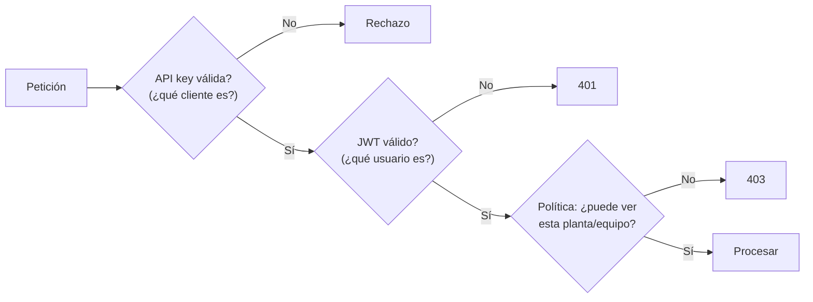

# 03 · Stack tecnológico y decisiones

## Tabla de tecnologías

| Capa | Selección | Para qué sirve aquí |
|---|---|---|
| Repositorio | GitHub | Código, PRs, CI. |
| API | FastAPI + Pydantic | Endpoints HTTP con validación automática de entrada/salida. |
| Runtime principal | AWS Lambda (contenedor) + API Gateway | Consultas cortas, pago por uso. |
| Runtime alternativo | Amazon EC2 + Docker | Procesos largos o persistentes. |
| Modelo | OpenAI API, con adaptador **mock** | Generación de texto; el mock permite tests sin red. |
| Orquestación | LangGraph | Flujo explícito del agente como grafo. |
| RAG y adaptadores | LangChain | Retriever y piezas de integración. |
| Memoria | Supabase PostgreSQL | Incidentes, hipótesis, ejecuciones. |
| Historial semántico | Supabase pgvector | Búsqueda por similitud en fallas pasadas. |
| Herramientas | Servidor MCP + cliente MCP | Acceso a equipos/sensores simulados. |
| Autorización | JWT validado, RBAC/ABAC, políticas backend; IAM para AWS | Control de acceso por usuario, planta y equipo. |
| Secretos | AWS Secrets Manager | Llaves fuera del código. |
| Observabilidad | CloudWatch + OpenTelemetry (si está configurado) | Logs, métricas, trazas. |
| Infraestructura | Terraform | Infra como código. |
| CI/CD | GitHub Actions | Tests y releases automáticos. |
| Imagen | Docker + Amazon ECR | Empaquetado y registro. |

## Decisiones a tener presentes

### 1. API key ≠ autenticación de usuarios

- La **API key** de API Gateway sirve para **identificar clientes y aplicar planes de uso** (cuotas, límites).
- **No** dice *quién es el usuario* ni *qué puede ver*.
- Para eso se usa **JWT** validado (issuer, audience y firma configurables) + políticas por planta/equipo.

### 2. Lambda y EC2 comparten el mismo código

- La lógica vive en `app/`.
- Cambian solo: el **adaptador de entrada** (Mangum en Lambda, Uvicorn en EC2), el **empaquetado** y la **configuración**.
- API Gateway necesita **rutas explícitas** (`/diagnose/quick`, `/diagnose/extended`); **no** adivina qué consultas serán largas.

Detalle completo en [`04-arquitectura/02-lambda-vs-ec2.md`](04-arquitectura/02-lambda-vs-ec2.md).

### 3. Mock primero

Todo componente externo (OpenAI, AWS, Supabase en tests) debe tener un sustituto mock para que `pytest` sea rápido, gratuito y reproducible.
