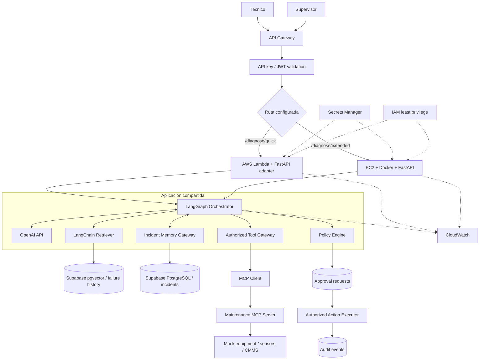

# 04.1 · Arquitectura objetivo

Es la foto final del sistema (al terminar V15). Cada versión construye una porción.

## Cómo leer el diagrama

Léelo en **cuatro zonas**, de arriba abajo:

| Zona | Componentes | Qué hace |
|---|---|---|
| **1. Entrada** | Técnico, Supervisor, API Gateway, API key/JWT, Router | Recibe la petición, identifica al cliente y al usuario, y la envía al runtime adecuado. |
| **2. Runtime** | Lambda o EC2 | Ejecuta la misma app; solo cambia dónde corre. |
| **3. Núcleo compartido** | LangGraph, OpenAI, Retriever, Tool Gateway, Memory Gateway, Policy Engine | El "cerebro": razona, busca, consulta herramientas, recuerda y decide qué está permitido. |
| **4. Datos y acciones** | Supabase (vectores e incidentes), MCP, Approval, Executor, Audit | Donde se guardan los datos y se ejecutan (simuladas) las acciones aprobadas. |

Las líneas **punteadas** (`-.->`) son soporte transversal: CloudWatch (logs), Secrets Manager (secretos), IAM (permisos AWS).

## Los "gateways": la idea central

Cada vez que el agente toca algo externo, pasa por una **puerta controlada** en lugar de acceder directamente:

| Gateway | Protege | Verifica |
|---|---|---|
| **Tool Gateway** | Herramientas MCP | Herramienta permitida, argumentos válidos, usuario autorizado. |
| **Memory Gateway** | Incidentes en Supabase | Que el usuario pueda leer/escribir ese incidente. |
| **Action Gateway / Policy Engine** | Acciones con efecto | Política, riesgo, necesidad de aprobación. |

> Idea: el LLM *propone*; el código determinista *decide*.

## Regla de seguridad del executor

El **Action Executor** solo actúa después de verificar:

1. **Identidad** (¿quién lo pide?).
2. **Alcance** (¿sobre qué planta/equipo?).
3. **Política** (¿está permitido?).
4. **Aprobación**, cuando aplique.
5. **Idempotencia** (¿ya se ejecutó?).

Estar conectado al servidor MCP **no otorga permisos** por sí solo.
