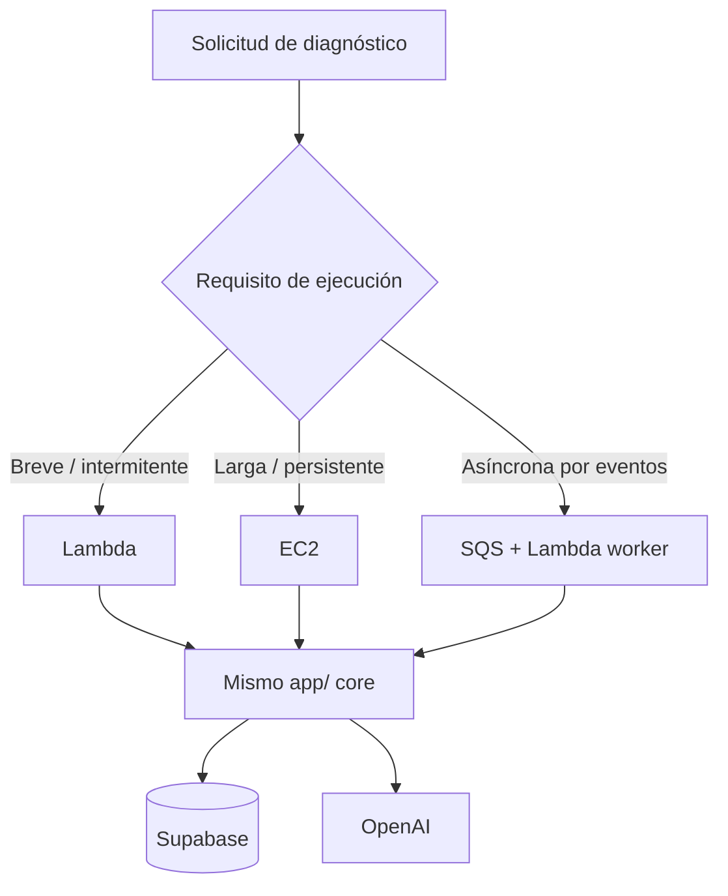

# 04.2 · Arquitectura A vs. B: Lambda vs. EC2

## La pregunta

¿Dónde corre el backend? Hay dos opciones y el taller muestra ambas con **el mismo código**.

## Comparación

| Criterio | Lambda | EC2 |
|---|---|---|
| Tráfico irregular y solicitudes breves | ✅ Preferida | Posible, pero hay capacidad encendida todo el tiempo |
| Ejecución individual > 15 minutos | ❌ No | ✅ Sí |
| Workflows largos asíncronos | SQS / Step Functions + estado persistido | Workers persistentes posibles |
| Servidor MCP remoto persistente | Requiere adaptar transporte/sesión | ✅ Conveniente |
| Control del SO y procesos de larga vida | Limitado | Mayor |
| Escalado | Gestionado, con cuotas | Hay que configurar ASG / balanceador |
| Mantenimiento de infraestructura | Menor | Mayor |
| Costos | Por invocación y duración | Por instancia aprovisionada |

**Analogía:** Lambda es un *taxi* (pagas el viaje, no mantienes el auto). EC2 es un *auto propio* (siempre disponible, pero pagas y mantienes aunque esté estacionado).

## Decisión para el workshop

- **Lambda** = despliegue principal para consultas **cortas**.
- **EC2** = demuestra el mismo backend como servicio **persistente** (ej.: servidor MCP remoto o procesamiento prolongado).
- **No** ejecutar dos copias del orquestador para una misma solicitud.
- En Lambda, un trabajo que **espera aprobación** se **persiste y se reanuda** después; no se mantiene una invocación abierta esperando (se pagaría y chocaría con el límite de 15 min).

## Cómo elegir según el requisito

### Cómo leerlo

- Las tres ramas terminan en el **mismo `app/`**. Eso es lo importante: no hay tres programas, hay uno con tres formas de arrancarlo.
- La tercera rama (SQS + worker) es para trabajos disparados por eventos, como ejecutar una acción ya aprobada.

## Qué cambia entre runtimes

| Aspecto | Lambda | EC2 |
|---|---|---|
| Punto de entrada | `handlers/lambda_api.py` (Mangum) | Uvicorn |
| Dockerfile | `Dockerfile.lambda` | `Dockerfile.ec2` |
| Ruta de API Gateway | `/diagnose/quick` | `/diagnose/extended` |
| Lógica de negocio | `app/` (idéntica) | `app/` (idéntica) |
