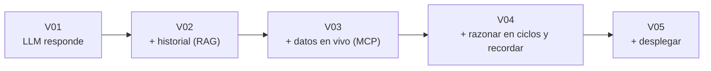

# Sesión 1 · AI Architecture (240 min)

**Meta:** construir un agente que funcione de punta a punta, aún sin controles de seguridad avanzados.

| Versión | Tema | Tiempo | Aporta |
|---|---|---|---|
| [V01](V01-fastapi-openai.md) | FastAPI + OpenAI | 35 min | Un endpoint que responde. |
| [V02](V02-rag-supabase.md) | RAG con Supabase | 45 min | Evidencia histórica. |
| [V03](V03-mcp-tools.md) | MCP tools | 45 min | Datos actuales de equipos/sensores. |
| [V04](V04-langgraph-memoria.md) | LangGraph + memoria | 50 min | Razonamiento iterativo y continuidad. |
| [V05](V05-lambda-vs-ec2.md) | Lambda vs. EC2 | 45 min | Despliegue en dos runtimes. |
| — | Cierre | 20 min | Repaso. |

## Progresión

Cada paso responde a una limitación del anterior:

- V01: el LLM inventa → V02 le da **historial real**.
- V02: el historial es pasado → V03 le da **mediciones actuales**.
- V03: una sola pasada no basta → V04 permite **iterar** y **recordar**.
- V04: corre en local → V05 lo **despliega**.
