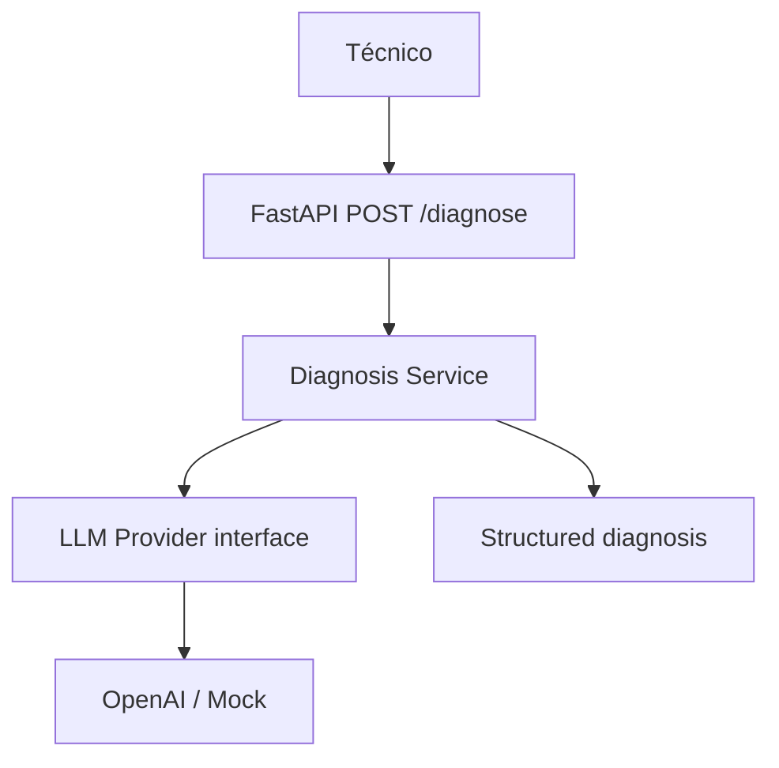

# V01 · FastAPI + OpenAI (35 min)

## Problema

Se necesita una forma de **hacer preguntas sobre incidentes** y recibir una respuesta estructurada.

## Idea en simple

Un endpoint HTTP recibe la pregunta, se la pasa a un "proveedor de LLM" y devuelve la respuesta en un formato fijo. El proveedor es **intercambiable**: OpenAI de verdad o un mock de pruebas.

## Qué se construye

- `POST /diagnose` con modelos Pydantic de entrada y salida.
- Interfaz `LLMProvider` con dos implementaciones: `OpenAIProvider` y `MockProvider`.
- Manejo de errores (timeout, proveedor caído, entrada inválida).
- `.env.example` (sin secretos reales), tests y README.

## Diagrama



### Cómo leerlo

1. El técnico llama a la API.
2. La ruta **no** habla con OpenAI; delega en el **Diagnosis Service**.
3. El servicio usa la **interfaz** `LLM Provider`. No sabe si detrás hay OpenAI o un mock.
4. El resultado se devuelve como diagnóstico estructurado.

**Por qué importa:** esa separación (ruta → servicio → interfaz → proveedor) es la que permite probar sin red y cambiar de proveedor sin tocar la lógica.

## Archivos probables

```text
app/api/main.py            app/api/routes/diagnose.py
app/llm/base.py            app/llm/openai_provider.py   app/llm/mock_provider.py
app/services/diagnosis.py  (o equivalente)
tests/unit/test_diagnose.py
.env.example   pyproject.toml   labs/V01/README.md
```

## Criterios de aceptación

- [ ] El endpoint devuelve **respuesta estructurada**.
- [ ] Hay test con **proveedor mock** (sin red).
- [ ] **No hay secretos** hardcodeados.

## Cómo verificar

```bash
pytest                       # debe pasar sin red
uvicorn app.api.main:app     # luego POST /diagnose con el ejemplo de P-204
```

## Errores comunes

- Llamar a OpenAI directamente desde la ruta (rompe la intercambiabilidad).
- Poner la API key en el código o en `.env` versionado.
- Devolver texto libre en vez de un modelo Pydantic.

## Qué habilita

V02 reutiliza el servicio y añade evidencia recuperada.
