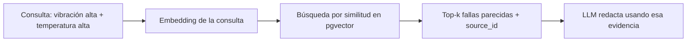
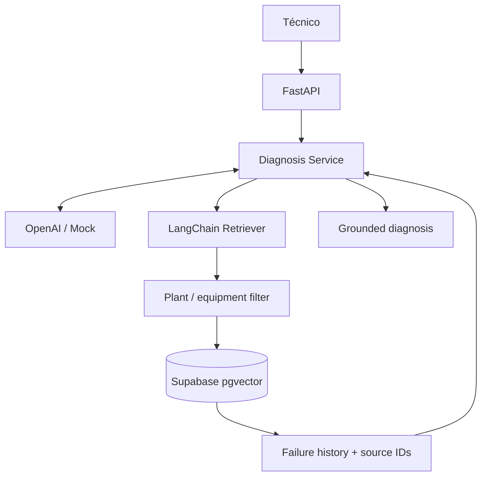

# V02 · RAG con Supabase (45 min)

## Problema

El LLM **no conoce el historial de fallas de tu planta**. Sin evidencia, tiende a inventar.

## Idea en simple

**RAG** = "buscar antes de responder". Se guardan las fallas pasadas como vectores (embeddings). Ante una consulta, se recuperan las más parecidas y se entregan al LLM como evidencia, **con su identificador de origen** para poder citarlas.



## Qué se construye

- **Ingesta** de fallas sintéticas: dividir en chunks, generar embeddings, guardar en `failure_history_chunks`.
- Tabla con **pgvector**.
- **Retriever LangChain** con filtro por planta y equipo.
- Citas con `source_id` en la respuesta.

## Diagrama



### Cómo leerlo

- El servicio ahora tiene **dos colaboradores**: el LLM y el retriever.
- El **filtro por planta/equipo** va *antes* de la base vectorial: solo se buscan documentos del ámbito correcto (base para la seguridad de V07).
- Lo que sale de la BD son **fallas + `source_id`**, que vuelven al servicio.
- "Grounded diagnosis" = diagnóstico **fundamentado** en evidencia citable.

## Archivos probables

```text
app/retrieval/ingest.py     app/retrieval/retriever.py
supabase/migrations/*.sql   supabase/seed.sql
data/history/*              tests/unit/test_retriever.py
labs/V02/README.md
```

## Criterios de aceptación

- [ ] Recupera fallas **relevantes**.
- [ ] Conserva el `source_id` de cada fragmento.
- [ ] **Filtra** por equipo/planta.
- [ ] **No inventa fuentes** (toda cita corresponde a un documento recuperado).

## Cómo verificar

- Test con embeddings mock/deterministas: la consulta de P-204 devuelve fallas de bombas.
- Test negativo: una consulta de PLANT-A no devuelve documentos de PLANT-B.
- Test: toda cita en la respuesta existe en los resultados recuperados.

## Errores comunes

- Perder el `source_id` al hacer chunking.
- Buscar sin filtro (fuga entre plantas).
- Aceptar citas que el LLM "recordó" y no provienen del retriever.

## Qué habilita

V03 añade mediciones actuales; V06 tratará el contenido recuperado como **no confiable**.
