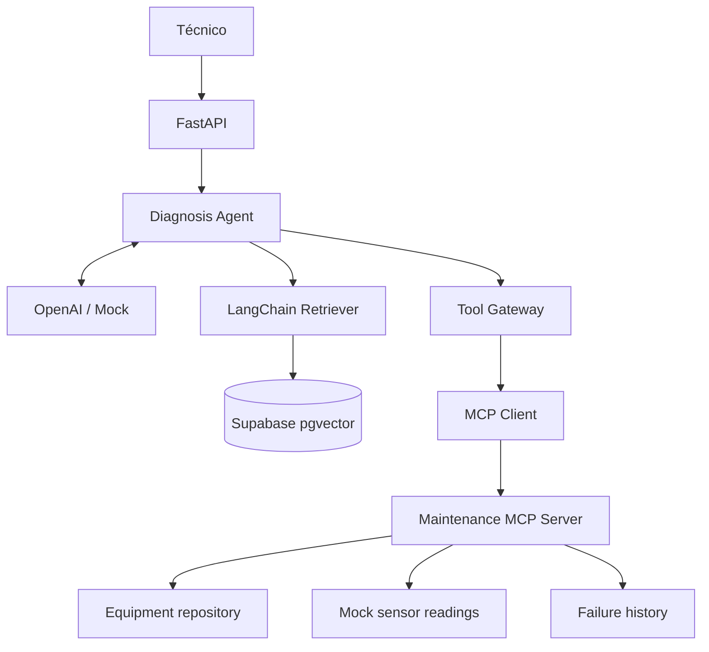

# V03 · MCP tools (45 min)

## Problema

El RAG aporta **historia**, pero no **mediciones actuales** ni datos maestros del equipo.

## Idea en simple

**MCP** es un estándar para que el agente *descubra* y *llame* herramientas. Montamos un servidor con tres herramientas, un cliente que lo consume y un **Tool Gateway** que valida todo antes de llamar.

| Herramienta | Devuelve |
|---|---|
| `get_equipment_info` | Modelo, criticidad, ubicación, mantenimiento programado. |
| `get_sensor_readings` | Temperatura, vibración, presión (simulados). |
| `get_failure_history` | Fallas previas del equipo. |

## Qué se construye

- **Servidor MCP** de mantenimiento con las 3 herramientas.
- **Cliente MCP**.
- **Tool Gateway** con contratos tipados (Pydantic) de entrada y salida.
- Repositorios simulados de equipos, sensores e historial.

## Diagrama



### Cómo leerlo

- El agente tiene dos fuentes: **Retriever** (pasado) y **Tool Gateway** (presente).
- El agente **nunca** habla directo con el servidor MCP: pasa por *Gateway → Client → Server*.
- El servidor MCP se apoya en tres repositorios simulados.

**Por qué un Gateway:** es el lugar único donde luego se añadirán allowlist, autorización y validación (V06–V08).

## Archivos probables

```text
app/mcp/server.py   app/mcp/client.py   app/mcp/tool_gateway.py
app/repositories/equipment.py   app/repositories/history.py
data/equipment/*   data/sensors/*
tests/unit/test_tool_gateway.py   labs/V03/README.md
```

## Criterios de aceptación

- [ ] **Descubrimiento** de herramientas (listar las disponibles).
- [ ] **Validación de argumentos** (ej.: `equipment_id` ausente → error claro).
- [ ] **Resultados tipados**.
- [ ] **Rechazo de herramienta inexistente**.

## Cómo verificar

- Test: listar herramientas devuelve las 3.
- Test: llamar `get_sensor_readings("P-204")` devuelve 86 °C / 8.4 mm/s / 2.8 bar.
- Test negativo: llamar `delete_everything` → rechazado.
- Test negativo: argumentos con tipo incorrecto → error de validación.

## Errores comunes

- Dejar que el LLM invente nombres de herramientas sin validar.
- Devolver diccionarios sin tipo.
- Asumir que "estar conectado al MCP" ya autoriza (se corrige en V08).
