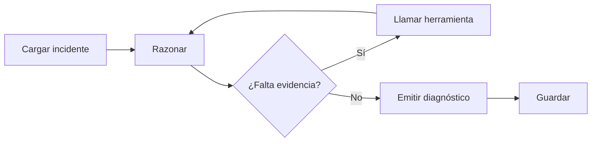
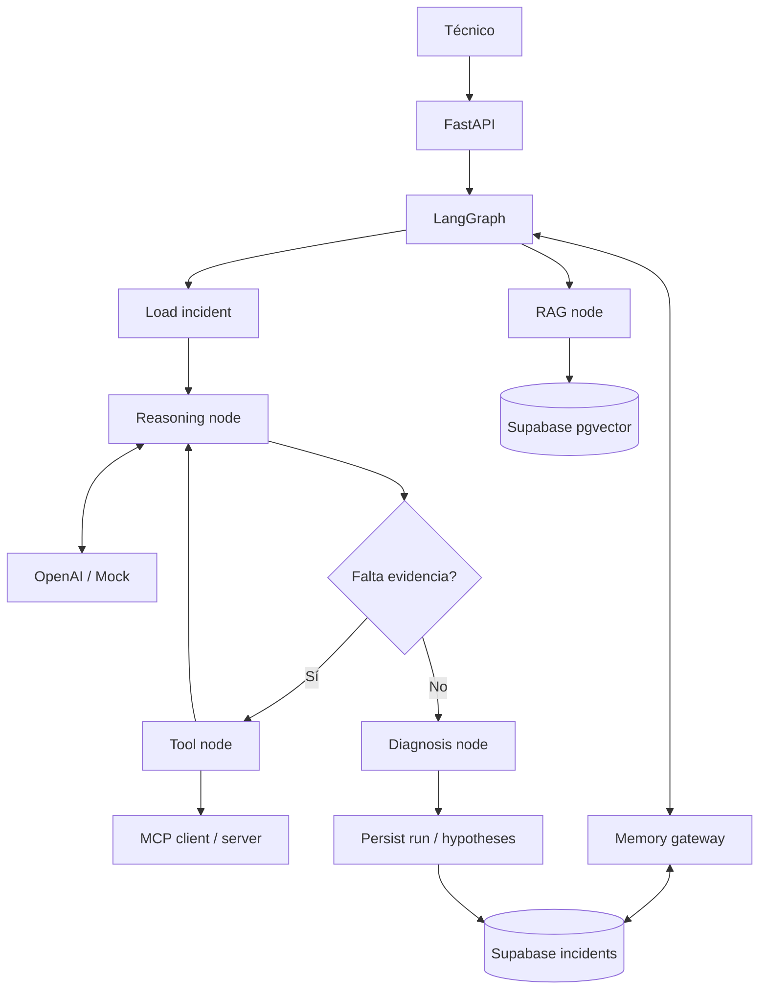

# V04 · LangGraph + memoria (50 min)

## Problema

Un diagnóstico real es **iterativo**: se razona, se descubre que falta un dato, se consulta una herramienta y se vuelve a razonar. Además, el caso debe poder **retomarse** en otra solicitud.

## Idea en simple

Se reemplaza la llamada única al LLM por un **grafo explícito** de pasos:



Un **`max_steps`** corta el ciclo para evitar bucles infinitos (y costos).

## Qué se construye

- Grafo LangGraph: nodos *load incident*, *reasoning*, *tools*, *RAG*, *diagnosis*, *persist*.
- Estado tipado (`state.py`).
- **Memory Gateway** para leer/escribir incidentes en Supabase.
- Persistencia de ejecuciones (`agent_runs`), observaciones e hipótesis.
- **Separación estricta de hechos e hipótesis.**

## Diagrama



### Cómo leerlo

- **Load incident:** si `INC-204` ya existe, se carga su estado previo (así se "reanuda").
- **Reasoning node ↔ LLM:** piensa y decide si tiene evidencia suficiente.
- **Decisión "¿falta evidencia?":** si sí → *Tool node* consulta MCP y **vuelve** a razonar (el ciclo). Si no → *Diagnosis node*.
- **RAG node:** aporta historial al razonamiento.
- **Persist:** guarda ejecución, observaciones e hipótesis.

## Hechos vs. hipótesis

| Tipo | Origen | Se guarda como |
|---|---|---|
| **Hecho / observación** | Sensor o dato verificable | `observations` |
| **Hipótesis** | Inferencia del modelo | `hypotheses` (con confianza y evidencia asociada) |

Mezclarlos es peligroso: una hipótesis guardada como hecho **contamina** futuras respuestas.

## Archivos probables

```text
app/agents/graph.py   app/agents/state.py   app/agents/nodes.py
app/memory/gateway.py   app/repositories/incidents.py
supabase/migrations/* (incidents, observations, hypotheses, agent_runs)
tests/unit/test_graph.py   labs/V04/README.md
```

## Criterios de aceptación

- [ ] **Reanuda `INC-204`** con su estado previo.
- [ ] **Guarda evidencia y estado**.
- [ ] **Limita iteraciones** (`max_steps`).
- [ ] **No confunde hipótesis con hechos**.

## Cómo verificar

- Test: dos solicitudes sobre INC-204; la segunda ve lo guardado por la primera.
- Test: con mock que siempre pide más herramientas, el grafo termina en `max_steps`.
- Test: una hipótesis nunca aparece en `observations`.

## Errores comunes

- Bucles sin límite.
- Guardar el razonamiento interno privado del modelo (solo decisiones y evidencia auditables).
- Estado mutable compartido entre solicitudes.
