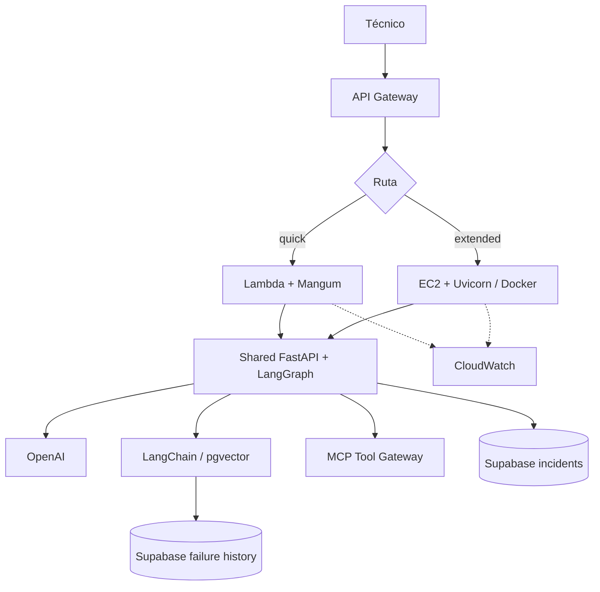

# V05 · Lambda vs. EC2 (45 min)

## Problema

Hay que decidir **dónde desplegar el mismo runtime** y demostrar que funciona en ambos.

## Idea en simple

Un solo código (`app/`), dos formas de arrancarlo. Se comparan latencia, costo y limitaciones. Ver el razonamiento completo en [`../04-arquitectura/02-lambda-vs-ec2.md`](../04-arquitectura/02-lambda-vs-ec2.md).

## Qué se construye

- **Docker** para ambos runtimes (`Dockerfile.lambda`, `Dockerfile.ec2`).
- **Handler Mangum** para Lambda (`handlers/lambda_api.py`).
- Arranque **Uvicorn** para EC2.
- Rutas comparativas: `/diagnose/quick` y `/diagnose/extended`.
- **CloudWatch** básico (logs).

> La infraestructura (API Gateway, Lambda, EC2) ya viene **preparada por el instructor**. Aquí no se hace `terraform apply`.

## Diagrama



### Cómo leerlo

- API Gateway enruta por **ruta explícita**; no decide por duración.
- Ambos runtimes convergen en **la misma app** (FastAPI + LangGraph).
- Hacia abajo, la app usa los mismos servicios (OpenAI, pgvector, MCP, incidentes).
- Ambos emiten logs a **CloudWatch** (línea punteada).

## Archivos probables

```text
handlers/lambda_api.py
Dockerfile.lambda   Dockerfile.ec2   docker-compose.yml
tests/integration/test_runtime_parity.py
labs/V05/README.md   (incluye tabla de latencias y comparación de costos)
```

## Criterios de aceptación

- [ ] **El mismo test de diagnóstico** pasa en Lambda y en EC2.
- [ ] **Latencias registradas** de ambos.
- [ ] **Comparación escrita** de costos y limitaciones.

## Cómo verificar

```bash
docker build -f Dockerfile.lambda -t maint-lambda .
docker build -f Dockerfile.ec2    -t maint-ec2 .
# Mismo payload de INC-204 contra ambos; comparar respuesta y tiempo.
```

## Errores comunes

- Duplicar lógica en el handler de Lambda.
- Ejecutar dos orquestadores para la misma petición.
- Mantener una Lambda abierta esperando una aprobación humana (se persiste y se reanuda).

## Fin de la Sesión 1

Ya existe un agente funcional y desplegable. **La Sesión 2 asume que alguien intentará engañarlo o abusar de él.**
