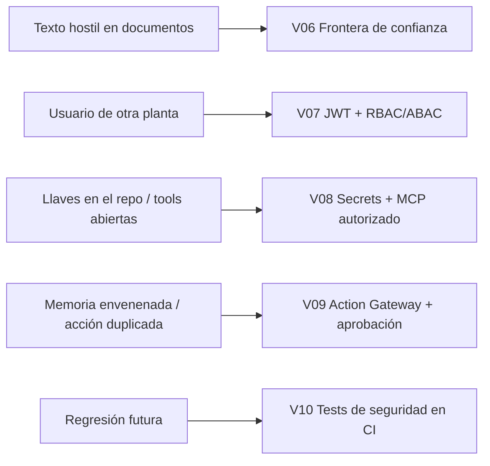
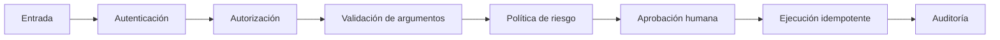

# Sesión 2 · AI Security (240 min)

**Meta:** asumir que habrá atacantes y errores, y demostrarlo con pruebas automáticas.

| Versión | Tema | Tiempo | Amenaza que cubre |
|---|---|---|---|
| [V06](V06-prompt-injection.md) | Trust boundaries / prompt injection | 45 min | Documentos hostiles que dan órdenes al LLM. |
| [V07](V07-jwt-rbac-abac.md) | JWT + RBAC/ABAC | 50 min | Acceso cruzado entre plantas/equipos. |
| [V08](V08-secrets-mcp-seguro.md) | Secrets Manager + MCP seguro | 45 min | Credenciales expuestas, herramientas sin control. |
| [V09](V09-memoria-segura-acciones.md) | Memoria segura + acciones aprobadas | 50 min | Memoria contaminada, acciones sin aprobación, duplicados. |
| [V10](V10-security-ci.md) | Security CI | 30 min | Regresiones que reabren vulnerabilidades. |
| — | Cierre | 20 min | Repaso. |

## Mapa de amenazas → defensa

## Principio transversal: defensa en profundidad

**Ninguna defensa depende solo del prompt.** Un prompt que dice "no hagas cosas malas" es una sugerencia, no un control. Los controles reales son **código determinista** que se ejecuta *fuera* del LLM: validación, autorización, políticas, aprobaciones.

