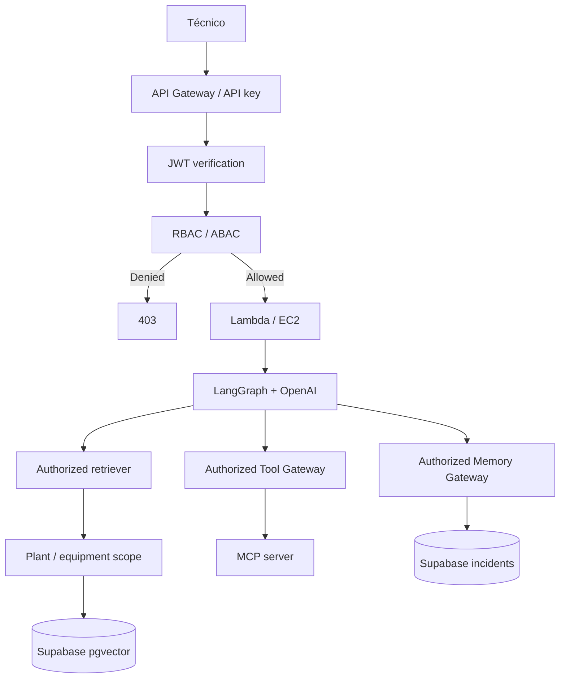
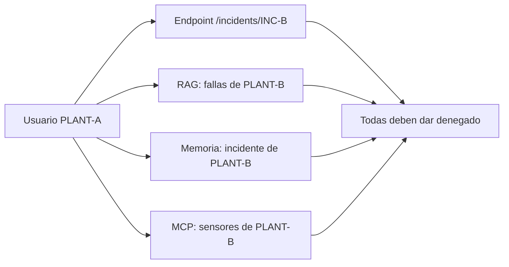

# V07 · JWT + RBAC/ABAC (50 min)

## Problema

Debe haber **aislamiento entre plantas y equipos**. Un técnico de PLANT-A no debe ver nada de PLANT-B.

## Idea en simple

Dos preguntas, dos mecanismos:

| Pregunta | Mecanismo |
|---|---|
| ¿Quién eres? | **JWT** verificado (firma, issuer, audience, expiración). |
| ¿Qué puedes hacer sobre *este* recurso? | **RBAC** (por rol) + **ABAC** (por atributos: planta, equipo, incidente). |

Ejemplo:

| Perfil | Rol | Plantas | Puede |
|---|---|---|---|
| Ana | technician | PLANT-A | Diagnosticar en PLANT-A. |
| Luis | supervisor | PLANT-A | + aprobar acciones en PLANT-A. |
| Root | administrator | todas | Administración. |

## Qué se construye

- Verificación de JWT (`authentication.py`).
- Motor de autorización (`authorization.py`): rol + planta + equipo + incidente.
- **Filtros de alcance** aplicados en: endpoint, **RAG**, **memoria** y **MCP**.

## Diagrama



### Cómo leerlo

- El rechazo (**403**) ocurre **antes** de entrar al runtime.
- Después de pasar, el **alcance** (planta/equipo) viaja con la petición y se aplica en **tres puertas**: retriever, tool gateway y memory gateway.
- Un fallo en una sola puerta bastaría para filtrar datos; por eso las tres tienen que comprobarlo.

## Las cuatro rutas de fuga que hay que cerrar



## ⚠️ IAM no protege filas de Supabase

IAM controla recursos **de AWS**. Las filas de Supabase se protegen con **RLS** y/o con **verificación en el backend en cada operación** (ver [`../09-esquema-datos.md`](../09-esquema-datos.md)).

## Archivos probables

```text
app/security/authentication.py   app/security/authorization.py
app/api/routes/* (dependencias de auth)
tests/security/test_access_control.py   labs/V07/README.md
```

## Criterios de aceptación

- [ ] Usuario PLANT-A **no puede leer PLANT-B** vía: endpoint, RAG, memoria **ni** MCP.

## Cómo verificar

Test parametrizado: para cada una de las cuatro rutas, un token PLANT-A pidiendo datos PLANT-B → 403 / resultado vacío. Más tests de JWT expirado, firma inválida y audience incorrecta.

## Errores comunes

- Autorizar solo en el endpoint y olvidar RAG/memoria/MCP.
- Tomar la planta del **body** de la petición en vez del **token**.
- Usar credenciales privilegiadas de Supabase sin filtrar en el backend.
