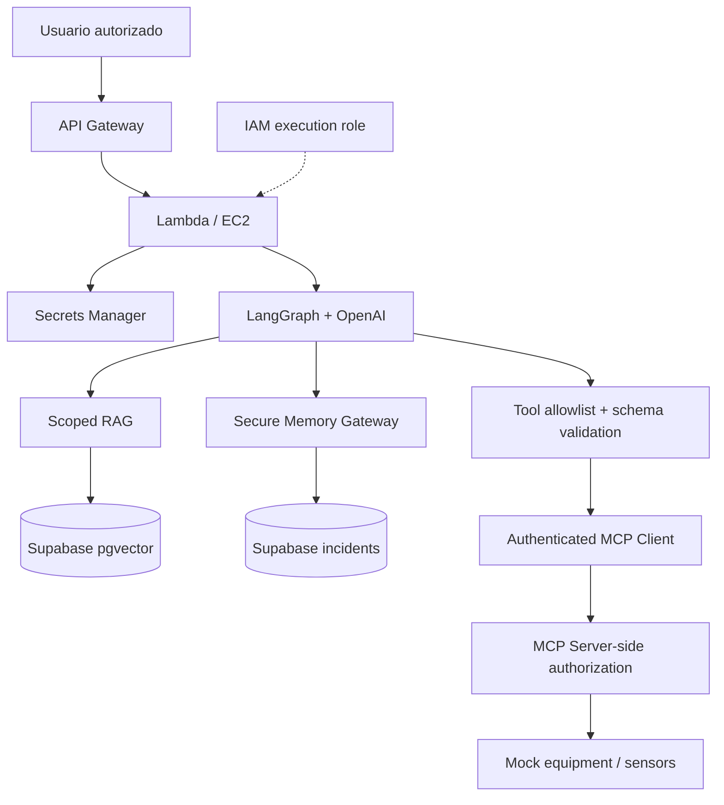

# V08 · Secrets Manager + MCP seguro (45 min)

## Problema

- Credenciales expuestas (en código, logs, repo o estado de Terraform).
- Permisos excesivos en AWS.
- Herramientas MCP accesibles a cualquiera que se conecte.

## Idea en simple

| Riesgo | Control |
|---|---|
| Llaves en el repo | **Secrets Manager**: se leen en tiempo de ejecución. |
| Rol AWS con permisos de más | **IAM mínimo**: solo leer los secretos necesarios, escribir sus logs. |
| El agente llama cualquier herramienta | **Allowlist** de herramientas + validación de esquema. |
| El servidor MCP confía en el cliente | **Autorización también en el servidor MCP** (doble verificación). |

> **Defensa en ambos lados:** el gateway del cliente valida, *y* el servidor vuelve a validar. Si alguien se salta el cliente, el servidor sigue protegiendo.

## Qué se construye

- Recuperación de secretos en runtime (`secrets.py`).
- Políticas IAM mínimas para Lambda y EC2, documentadas.
- Allowlist de herramientas y validación de esquema en el Tool Gateway.
- Cliente MCP autenticado; autorización en el servidor.

## Diagrama



### Cómo leerlo

- El **rol IAM** (punteado) define qué puede hacer el runtime en AWS.
- El runtime pide secretos a **Secrets Manager** cuando los necesita, no al empaquetar.
- La cadena de herramientas tiene **dos controles**: allowlist en el gateway y autorización en el servidor.

## Qué NO debe aparecer nunca

| Lugar | Debe estar libre de secretos |
|---|---|
| Código fuente | ✅ |
| `.env` versionado (solo `.env.example` sin valores reales) | ✅ |
| Logs y trazas | ✅ (redacción) |
| Estado de Terraform | ✅ (Terraform crea el *contenedor* del secreto, no su valor) |

## Archivos probables

```text
app/security/secrets.py
app/mcp/tool_gateway.py   app/mcp/server.py (authz)
infrastructure/terraform/modules/iam/*
docs/threat-model/iam-policies.md   tests/security/test_secrets_and_mcp.py
labs/V08/README.md
```

## Criterios de aceptación

- [ ] **Ninguna credencial** en repo ni logs.
- [ ] **Rechazo de herramienta no autorizada**.
- [ ] **Políticas IAM mínimas documentadas**.

## Cómo verificar

- Escaneo del repo (ej. búsqueda de patrones de llaves) sin hallazgos.
- Test: usuario sin permiso invoca herramienta restringida → rechazo tanto en gateway como en servidor.
- Test: logs de una ejecución no contienen el valor del secreto.

## Errores comunes

- Rol IAM con `*` en acciones o recursos.
- Imprimir configuración completa en logs de arranque.
- Autorizar solo en el cliente MCP.
