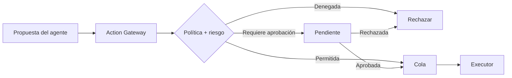
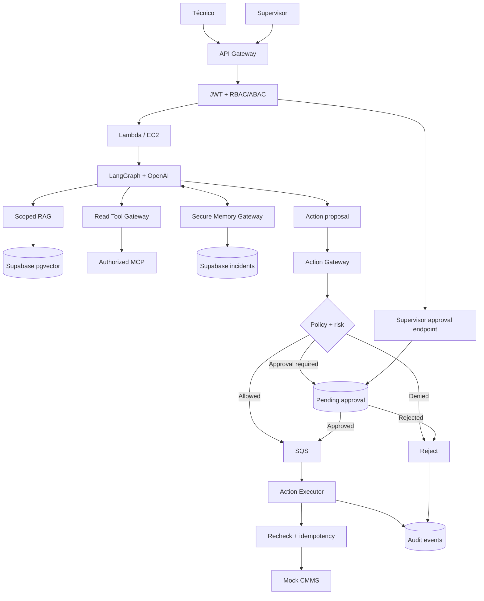
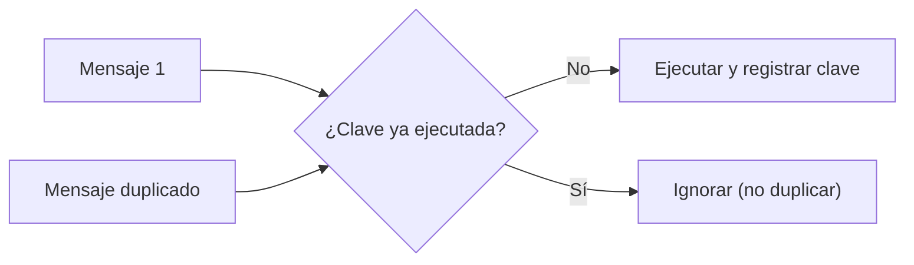

# V09 · Memoria segura + acciones aprobadas (50 min)

## Problema

1. La **memoria puede contaminarse** (el agente guarda algo falso o en el incidente equivocado).
2. Una **acción con efecto** (ej. publicar una orden de trabajo) podría ejecutarse **sin aprobación** o **duplicarse** por reintentos.

## Idea en simple

El LLM **propone** una acción; no la ejecuta. La propuesta pasa por un **Action Gateway** que aplica políticas deterministas. Si requiere aprobación, queda **pendiente** hasta que un supervisor la apruebe. Luego un **Executor** la realiza una sola vez.



## Qué se construye

- **Validación de escrituras en memoria** (solo en incidentes del alcance del usuario; formato esperado).
- **Action Gateway** + políticas deterministas.
- Flujo de **aprobación humana** (endpoint del supervisor).
- **Executor idempotente** que rechequea antes de actuar.
- Eventos de **auditoría**.

## Diagrama



### Cómo leerlo

- **Lectura vs. escritura están separadas:** *Read Tool Gateway* (solo consulta) vs. *Action Gateway* (con efecto).
- **Tres salidas de la política:** denegar, permitir directo (cola) o exigir aprobación (pendiente).
- El **supervisor** aprueba por su propio endpoint, que también pasa por JWT + RBAC/ABAC.
- El **Executor no confía ciegamente** en la cola: **rechequea** permisos, aprobación e idempotencia antes de tocar el CMMS.
- Todo desenlace (rechazo, ejecución) escribe **auditoría**.

## Idempotencia explicada

Los mensajes de cola pueden llegar **dos veces**. Se usa una **clave de idempotencia** (ej. `action_id + versión`):



También hay que defender contra **replay**: reutilizar una aprobación vieja o ya consumida.

## Archivos probables

```text
app/memory/gateway.py   app/actions/gateway.py   app/actions/executor.py
app/governance/policies.py   app/governance/approvals.py   app/governance/audit.py
tests/security/test_actions.py   labs/V09/README.md
```

## Criterios de aceptación

- [ ] Una orden de trabajo **no se publica sin aprobación válida**.
- [ ] **Reintentos no duplican** acciones.
- [ ] **Escritura cruzada** de incidentes **bloqueada**.

## Cómo verificar

- Test: ejecutar sin aprobación → rechazado.
- Test: aprobación válida → una orden en el CMMS mock.
- Test: reenviar el mismo mensaje → sigue habiendo una orden.
- Test: reusar una aprobación ya consumida → rechazado.
- Test: escribir en un incidente de otra planta → bloqueado.

## Errores comunes

- Dejar que el LLM llame directo al CMMS.
- Verificar la aprobación solo al encolar y no al ejecutar.
- Idempotencia basada en tiempo en vez de en una clave estable.
