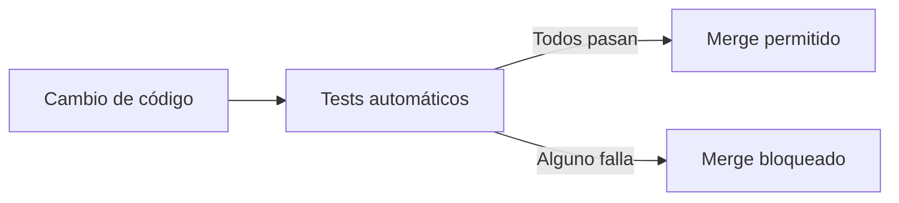
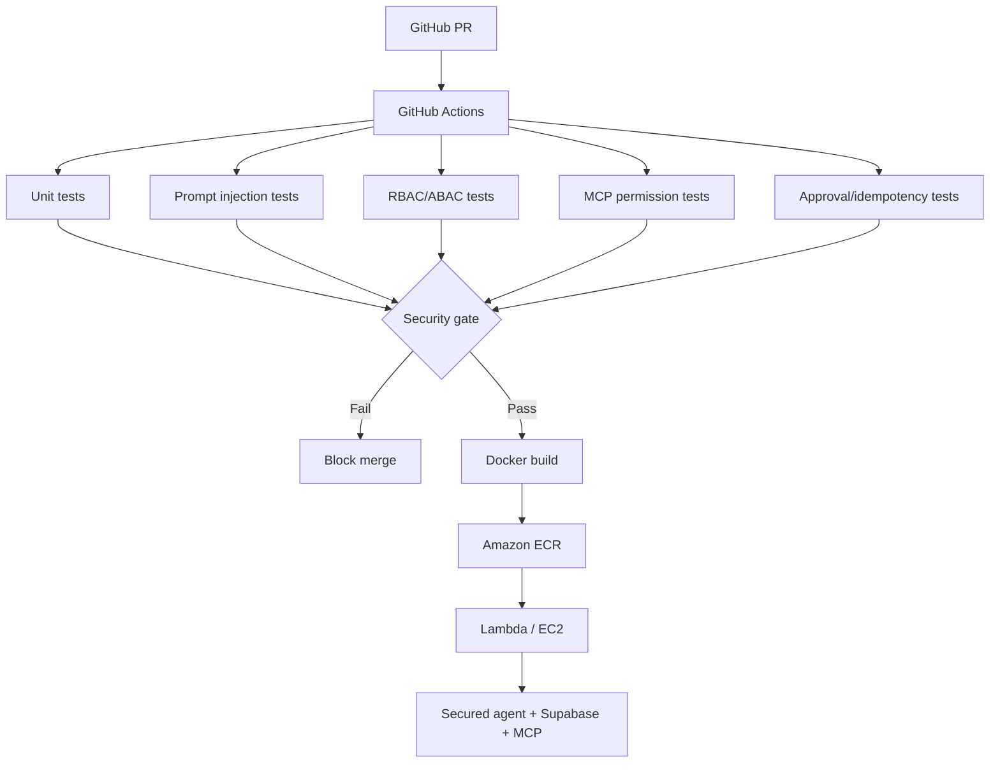

# V10 · Security CI (30 min)

## Problema

Los controles de V06–V09 funcionan **hoy**. Un cambio futuro puede **reabrir** una vulnerabilidad sin que nadie lo note.

## Idea en simple

Convertir cada ataque en un **test automático** que corre en cada Pull Request. Si falla uno de seguridad, **el merge se bloquea**.



## Qué se construye

Suites pytest, ejecutadas por GitHub Actions:

| Suite | Verifica |
|---|---|
| Unit | Lógica básica. |
| Prompt injection | V06: documentos hostiles no producen acciones. |
| RBAC/ABAC | V07: aislamiento entre plantas. |
| MCP permissions | V08: herramientas no autorizadas rechazadas. |
| Approval/idempotency | V09: sin aprobación no hay ejecución; sin duplicados. |

## Diagrama



### Cómo leerlo

- Las **cinco suites corren en paralelo** y convergen en un **Security gate**.
- Si **cualquiera** falla → se bloquea el merge.
- Solo si todas pasan se construye la imagen Docker y se publica a **ECR**.

## Prueba clave: "romper a propósito"

1. Introducir intencionalmente un fallo de aislamiento (ej. quitar el filtro de planta).
2. Verificar que **CI falla**.
3. Reparar.
4. Verificar que **CI vuelve a pasar**.

Esto demuestra que los tests realmente protegen, no que existen por decoración.

## Archivos probables

```text
.github/workflows/ci.yml
tests/unit/   tests/security/
labs/V10/README.md
```

## Criterios de aceptación

- [ ] Un fallo de aislamiento introducido a propósito **hace fallar CI**.
- [ ] La reparación **vuelve a pasar**.

## Errores comunes

- Tests que dependen de red o de claves reales (flaky).
- Marcar los tests de seguridad como "opcionales" en el pipeline.
- No tener casos negativos (solo se prueba que lo permitido funciona).

## Fin de la Sesión 2

El agente ya es **seguro por diseño y verificable**. La Sesión 3 añade **gobierno**: políticas, medición, trazabilidad y despliegue controlado.
