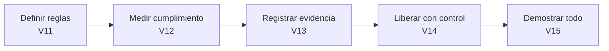

# Sesión 3 · AI Governance (240 min)

**Meta:** que el sistema sea **controlable, medible, auditable y desplegable** con garantías.

| Versión | Tema | Tiempo | Pregunta de gobierno |
|---|---|---|---|
| [V11](V11-politicas-riesgo-hitl.md) | Políticas de riesgo y HITL | 45 min | ¿Cuánta autonomía se le permite? |
| [V12](V12-evaluacion.md) | Evaluación golden/adversarial | 50 min | ¿Es suficientemente bueno y seguro para liberar? |
| [V13](V13-observabilidad-auditoria.md) | Observabilidad y auditoría | 45 min | ¿Puedo reconstruir qué pasó y por qué? |
| [V14](V14-terraform-cicd.md) | Terraform + CI/CD + Docker + ECR | 50 min | ¿Cómo libero cambios con control y reversa? |
| [V15](V15-end-to-end-p204.md) | End-to-end P-204 | 30 min | ¿Todo funciona junto? |
| — | Cierre | 20 min | Repaso. |

## Seguridad vs. gobierno

| | Seguridad (S2) | Gobierno (S3) |
|---|---|---|
| Enfoque | Impedir abusos y ataques | Definir, medir y evidenciar el comportamiento aceptable |
| Ejemplo | Bloquear acceso cruzado | Demostrar con un scorecard que se bloquea, y registrar quién aprobó qué |
