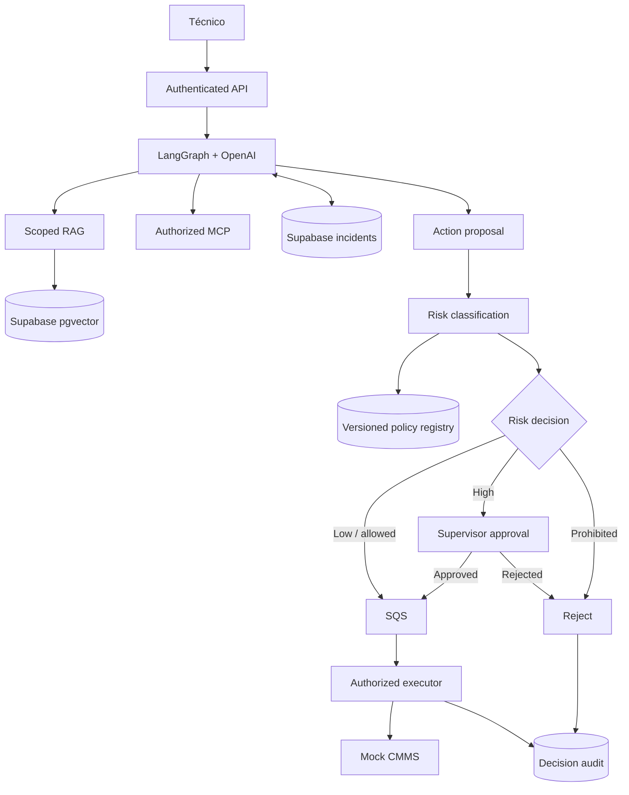

# V11 · Risk policy and HITL (45 min)

## Problema

Hay que **definir qué puede hacer el agente por sí solo**, qué requiere una persona y qué está prohibido, y que ese criterio sea **versionado y auditable**.

## Idea en simple

Una tabla de políticas decide, según el **riesgo** de la acción:

| Nivel | Qué ocurre | Ejemplos |
|---|---|---|
| **Permitido** (bajo riesgo) | Se ejecuta directo. | Consultar historial, leer sensores, crear un borrador. |
| **Requiere aprobación** (alto) | Un supervisor debe aprobar (HITL). | Publicar una orden de trabajo. |
| **Prohibido** | Siempre rechazado. | Control de PLC, cambiar setpoints. |

Cada cambio en la política genera una **nueva versión** y un **decision record** (quién, cuándo, por qué).

## Qué se construye

- **Registro de políticas versionadas** (`policy_versions`).
- **Clasificación de riesgo** de cada acción propuesta.
- **Decision records** auditables.
- Integración con el flujo de aprobación de V09.

## Diagrama



### Cómo leerlo

- La **clasificación de riesgo** consulta el **registro de políticas** (versionado): la misma acción puede tener otro resultado si cambió la política.
- Tres ramas: bajo → cola; alto → supervisor; prohibido → rechazo.
- Todas las decisiones terminan en **Decision audit**, incluso los rechazos.

## Por qué determinista

La clasificación **no** la hace el LLM. Un LLM puede equivocarse o ser manipulado; una tabla de reglas en código siempre da el mismo resultado ante la misma entrada, y se puede testear.

## Archivos probables

```text
app/governance/policies.py   app/governance/audit.py
supabase/migrations/* (policy_versions)
docs/governance/risk-policy.md
tests/unit/test_risk_policy.py   labs/V11/README.md
```

## Criterios de aceptación

- [ ] **Consultas** permitidas.
- [ ] **Borradores** permitidos.
- [ ] **Publicación** requiere aprobación.
- [ ] **Control de PLC siempre prohibido** (sin importar rol ni aprobación).

## Cómo verificar

- Test tabular: acción → decisión esperada.
- Test: incluso un administrador no puede ejecutar "ajustar setpoint".
- Test: cambiar la política crea una nueva versión y un decision record.

## Errores comunes

- Dejar que el modelo "califique" su propio riesgo.
- Permitir que una aprobación humana desbloquee una acción prohibida.
- Sobrescribir políticas sin versionar.
