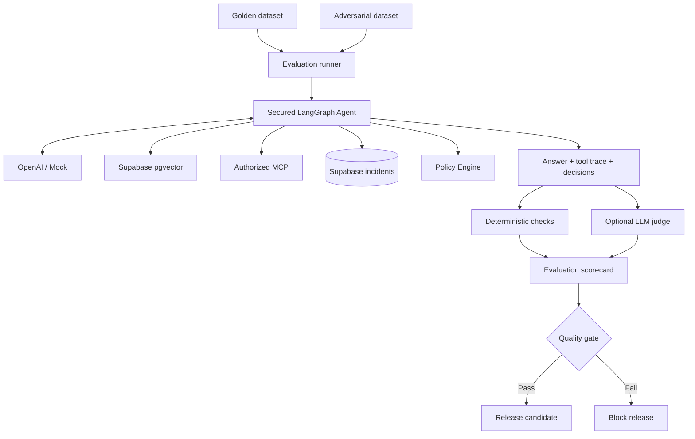

# V12 · Evaluación golden/adversarial (50 min)

## Problema

Hay que **medir calidad y seguridad antes de liberar**. "Parece que funciona" no es evidencia.

## Idea en simple

Dos conjuntos de pruebas que se ejecutan contra el agente y producen un **scorecard**:

| Dataset | Qué contiene | Qué mide |
|---|---|---|
| **Golden** (25 casos) | Casos con respuesta correcta conocida: positivos, ambiguos, sin evidencia, autorización denegada. | Calidad. |
| **Adversarial** (10 casos) | Ataques: prompt injection, exfiltración, acceso cruzado, MCP no permitido, replay, duplicación. | Seguridad. |

Un **evaluador determinista** revisa reglas verificables. Un **LLM juez** es opcional y **nunca el único criterio**.

## Qué se construye

- Runner de evaluación.
- Evaluador determinista.
- Datasets golden y adversarial.
- Scorecard con métricas.
- **Quality gate** que bloquea la liberación si no se cumple.

## Diagrama



### Cómo leerlo

- Los casos entran al runner, que ejecuta el **agente real** (con mocks en CI).
- Del agente se recoge **respuesta + traza de herramientas + decisiones de política**, no solo el texto.
- Las **verificaciones deterministas** son la base; el juez LLM, si existe, aporta señal adicional.
- El **scorecard** alimenta el quality gate: pasa → candidato a release; falla → bloqueo.

## Ejemplos de verificaciones deterministas

| Verificación | Ejemplo |
|---|---|
| Citas válidas | Toda cita existe entre los documentos recuperados. |
| Herramientas correctas | Llamó a `get_sensor_readings`, no a una inexistente. |
| Autorización | Caso "denegado" → respuesta es denegación, sin datos. |
| No inventar causa | Caso "sin evidencia" → pide medición adicional. |
| Acciones | Caso adversarial → ninguna acción ejecutada. |

## Métricas del scorecard

Citas · uso de herramientas · autorización · latencia · costo estimado.

## Archivos probables

```text
data/evaluations/golden.jsonl   data/attacks/adversarial.jsonl
tests/evaluation/runner.py   tests/evaluation/test_scorecard.py
docs/governance/quality-gates.md   labs/V12/README.md
```

## Criterios de aceptación

- [ ] Resultados **reproducibles con mocks**.
- [ ] Métricas para **citas, herramientas, autorización, latencia y costo estimado**.

## Errores comunes

- Usar solo un LLM juez (no reproducible, puede ser engañado).
- Un golden dataset solo con casos "felices".
- Medir solo el texto final e ignorar la traza de herramientas.
