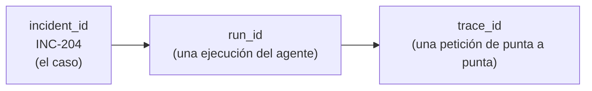
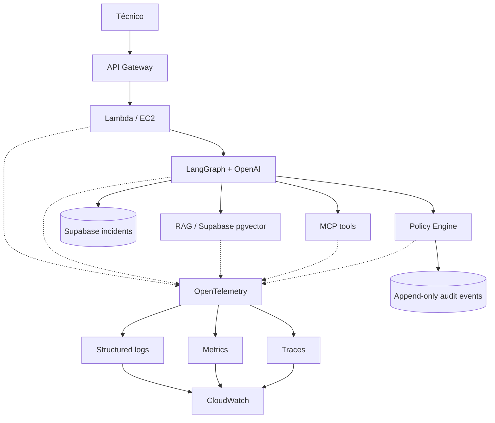

# V13 · Observabilidad y auditoría (45 min)

## Problema

Cuando algo sale mal o lento, hay que poder **reconstruir la ejecución**: qué se pidió, qué pasó en cada paso, quién decidió qué.

## Idea en simple

Tres cosas distintas que a menudo se confunden:

| | Para qué | Quién la usa | Mutabilidad |
|---|---|---|---|
| **Observabilidad** (logs, métricas, trazas) | Diagnosticar rendimiento y fallos. | Ingeniería/operaciones. | Se puede rotar o expirar. |
| **Auditoría** (audit events) | Probar quién hizo/decidió qué. | Gobierno, cumplimiento. | **Append-only** (solo se agrega). |
| **Memoria de negocio** (incidentes) | Continuidad del caso. | El agente y técnicos. | Se actualiza. |

Por eso la auditoría va en **almacenamiento separado**.

## Identificadores de correlación



Con ellos se puede preguntar: *"muéstrame todo lo que pasó en la ejecución X del incidente INC-204"*.

## Qué se construye

- Propagar `trace_id`, `incident_id`, `run_id` en toda la app.
- **Logs estructurados** (JSON).
- Métricas y trazas con **OpenTelemetry** (solo cuando haya exportador configurado).
- **Redacción** de secretos y PII.
- **Audit events** append-only para decisiones de autorización y políticas.

## Diagrama



### Cómo leerlo

- Cada componente emite señales (líneas punteadas) hacia **OpenTelemetry**, que las separa en logs, métricas y trazas, y las envía a **CloudWatch**.
- El **Policy Engine** además escribe directo a **audit events** (no depende del pipeline de observabilidad).
- La traza permite ver **latencia por nodo**: dónde se va el tiempo (¿LLM? ¿RAG? ¿MCP?).

## Qué se audita

| Evento | Ejemplo |
|---|---|
| Autorización | Usuario X, acceso a INC-B denegado. |
| Política | Acción Y clasificada alto riesgo, versión de política Z. |
| Aprobación | Supervisor S aprobó la acción A. |
| Ejecución | Orden creada en CMMS mock con clave K. |

⚠️ No registrar el **razonamiento interno privado** del modelo; solo decisiones y evidencia.

## Archivos probables

```text
app/observability/telemetry.py   app/governance/audit.py
tests/unit/test_redaction.py   labs/V13/README.md
```

## Criterios de aceptación

- [ ] Identificar **latencia por nodo**.
- [ ] **Correlacionar** incidente y ejecución.
- [ ] **Redactar** secretos/PII.
- [ ] Registrar **decisiones de autorización**.

## Errores comunes

- Mezclar auditoría con logs normales (se pierde inmutabilidad).
- Loguear tokens o cuerpos completos de petición.
- No propagar el `trace_id` a las herramientas MCP.
