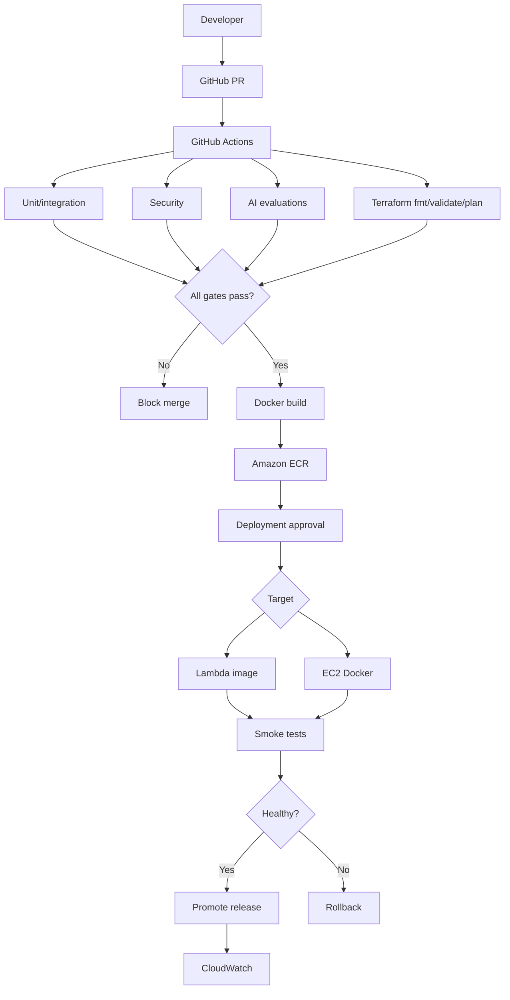

# V14 · Terraform + CI/CD + Docker + ECR (50 min)

## Problema

Desplegar cambios **con control de calidad y posibilidad de rollback**, sin intervenciones manuales ni deriva de configuración.

## Idea en simple

Dos responsabilidades separadas:

| Qué | Quién lo gestiona |
|---|---|
| **Infraestructura** (API Gateway, IAM, Lambda, ECR, colas, EC2…) | **Terraform** |
| **Releases** (qué versión de la imagen corre) | **Pipeline de GitHub Actions** |

El pipeline pasa por **puertas de calidad**; si alguna falla, no se libera.

## Qué se construye

- Terraform para la infraestructura.
- Workflows de Actions: pruebas, seguridad, evaluaciones IA, `terraform fmt/validate/plan`.
- Docker para ambos runtimes.
- Publicación en **ECR** y despliegue **por digest** (versión inmutable).
- Smoke tests y rollback documentado.

## Diagrama



### Cómo leerlo en tres fases

| Fase | Pasos | Objetivo |
|---|---|---|
| **1. Verificar** | Tests, seguridad, evaluaciones IA, Terraform plan → gate | Que lo que se mezcla sea bueno. |
| **2. Construir y aprobar** | Docker build → ECR → aprobación de despliegue | Artefacto inmutable + permiso humano. |
| **3. Desplegar y validar** | Lambda/EC2 → smoke tests → ¿sano? → promover o **rollback** | Liberar con red de seguridad. |

## Reglas de buena práctica

| Regla | Motivo |
|---|---|
| **OIDC** de GitHub a AWS, **sin access keys estáticas** | No hay llaves que filtrar. |
| `terraform apply` **solo con aprobación** | Cambios de infra controlados. |
| Desplegar por **digest** (no `latest`) | Se sabe exactamente qué corre; el rollback es volver al digest anterior. |
| Lambda usa imagen de **ECR** (no GHCR) | Requisito de Lambda. |
| **Ownership explícito** de la versión de imagen | Evita que Terraform y el pipeline se pisen (drift). |
| Backend remoto de estado (S3 cifrado, versionado, con lock) en un **bootstrap separado** | Estado seguro y sin secretos. |

## Archivos probables

```text
infrastructure/terraform/{bootstrap,modules,environments/dev,environments/workshop}
.github/workflows/ci.yml   .github/workflows/deploy.yml
docs/adr/*   labs/V14/README.md (incluye rollback)
```

## Criterios de aceptación

- [ ] CI **bloquea** fallos.
- [ ] Deploy con **digest/versión inmutable**.
- [ ] **Smoke tests** tras desplegar.
- [ ] **Rollback documentado**.
- [ ] Terraform administra infra; el pipeline administra releases, **sin drift no controlado**.

## Recordatorio

⚠️ **No ejecutar `terraform apply/destroy` sin confirmación explícita del operador.**
