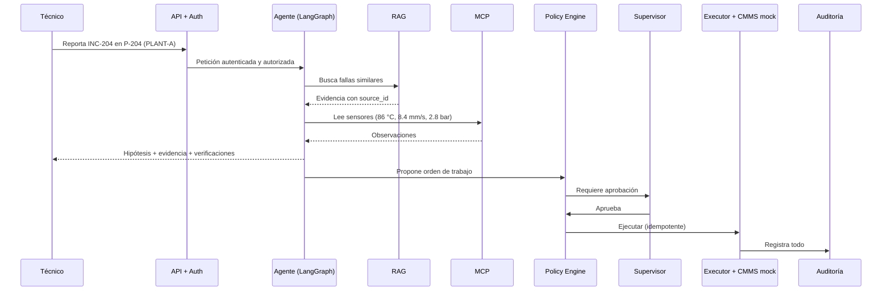
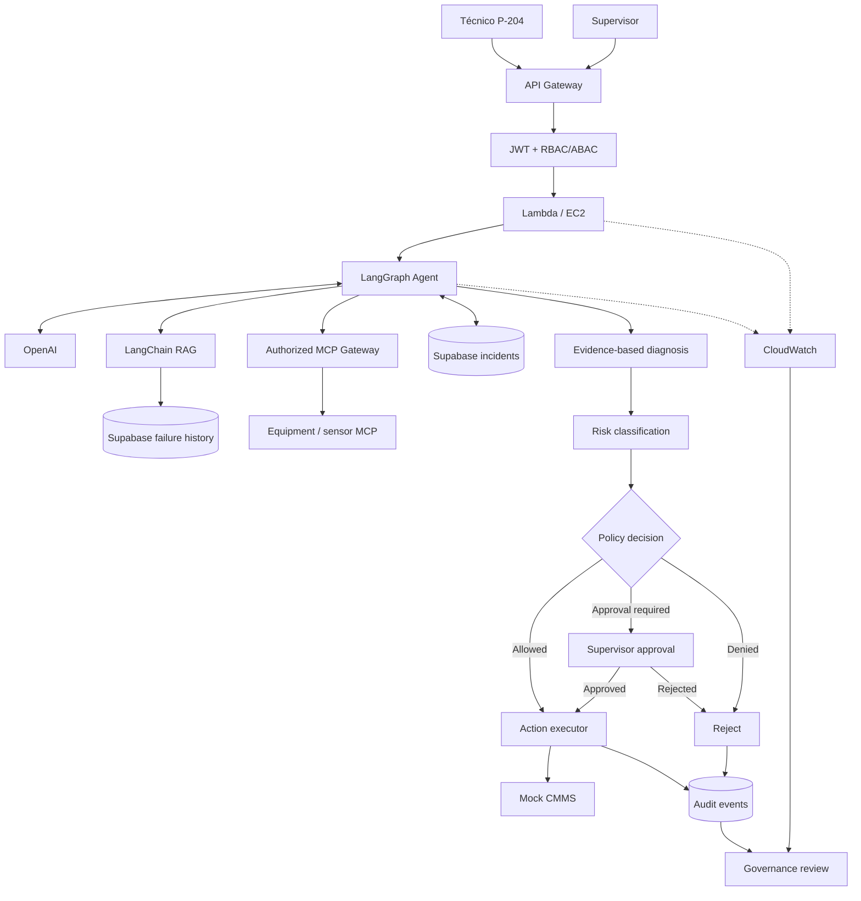

# V15 · End-to-end P-204 (30 min)

## Problema

Demostrar que **todo funciona integrado** y que los controles están activos en un escenario real (simulado).

## El escenario narrado

## Qué se construye

Un escenario completo con: incidente, evidencia citada, hipótesis, **propuesta de orden de trabajo** y **aprobación simulada**.

## Diagrama

### Cómo leerlo

Es la **suma de todo lo anterior**:

| Parte del diagrama | Viene de |
|---|---|
| Auth JWT + RBAC/ABAC | V07 |
| RAG con alcance | V02, V07 |
| MCP autorizado | V03, V08 |
| Memoria de incidentes | V04, V09 |
| Clasificación de riesgo y políticas | V11 |
| Aprobación, executor, CMMS mock | V09 |
| Auditoría y CloudWatch → **Governance review** | V13 |

El **Governance review** (al final) muestra el objetivo: que una persona pueda revisar, con evidencia, qué hizo el sistema.

## Checklist de la demo

- [ ] El diagnóstico **cita** fuentes y **distingue** observaciones de hipótesis.
- [ ] Un intento prohibido (ej. cambiar setpoint) es **rechazado**.
- [ ] La orden de trabajo **solo** se crea tras una aprobación **verificable**.
- [ ] Un reintento **no duplica** la orden.
- [ ] Todo es **rastreable** por `incident_id`, `run_id` y `trace_id`.

## Criterios de aceptación

- [ ] Flujo de punta a punta.
- [ ] Evidencia citada.
- [ ] **No** ejecución de acciones prohibidas.
- [ ] Aprobación verificable.
- [ ] Trazabilidad completa.
