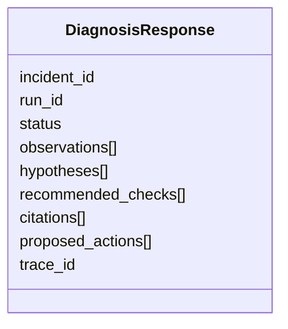

# 08 · Contratos de API

Se implementan **progresivamente**, no todos en V01.

## Endpoints

| Método | Ruta | Para qué | Versión aprox. |
|---|---|---|---|
| GET | `/health` | Comprobar que el servicio vive. | V01 |
| POST | `/diagnose` | Diagnóstico directo. | V01 |
| POST | `/incidents` | Crear un incidente. | V04 |
| GET | `/incidents/{incident_id}` | Leer un incidente. | V04 |
| POST | `/incidents/{incident_id}/diagnose` | Diagnosticar/reanudar un incidente. | V04 |
| GET | `/runs/{run_id}` | Ver una ejecución del agente. | V04/V13 |
| POST | `/approvals/{approval_id}/approve` | Supervisor aprueba una acción. | V09 |
| POST | `/approvals/{approval_id}/reject` | Supervisor rechaza una acción. | V09 |
| GET | `/incidents/{incident_id}/audit` | Auditoría del incidente. | V13 |

## Petición de diagnóstico

```json
{
  "incident_id": "INC-204",
  "equipment_id": "P-204",
  "plant_id": "PLANT-A",
  "symptoms": ["high_vibration", "high_bearing_temperature", "low_discharge_pressure"],
  "message": "Diagnostica la falla y recomienda verificaciones"
}
```

| Campo | Significado |
|---|---|
| `incident_id` | Caso de negocio (legible). |
| `equipment_id` | Equipo afectado. |
| `plant_id` | Planta; **debe coincidir con el alcance del token** (V07). |
| `symptoms` | Lista de códigos de síntoma. |
| `message` | Texto libre del técnico (**no confiable**). |

## Respuesta mínima

| Campo | Contenido |
|---|---|
| `incident_id` | Caso. |
| `run_id` | Esta ejecución. |
| `status` | Estado (ej. completado, requiere más datos, pendiente de aprobación). |
| `observations` | Hechos medidos. |
| `hypotheses` | Posibles causas, con confianza y evidencia. |
| `recommended_checks` | Verificaciones sugeridas. |
| `citations` | Fuentes (`source_id`) del historial. |
| `proposed_actions` | Acciones propuestas (aún no ejecutadas). |
| `trace_id` | Para correlacionar logs y trazas. |

Esquema ilustrativo:



## Regla importante

**Nunca** incluir el razonamiento interno privado del modelo. Se registran solo **decisiones y evidencia** aptas para auditoría.
