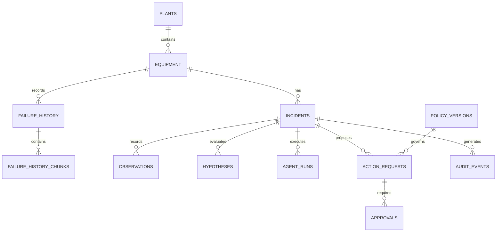

# 09 · Esquema de datos (Supabase)

## Tablas mínimas y su función

| Tabla | Guarda | Introducida en |
|---|---|---|
| `plants` | Plantas (PLANT-A/B/C). | V02 |
| `equipment` | Equipos (P-204…). | V02/V03 |
| `failure_history` | Fallas históricas con causa confirmada. | V02 |
| `failure_history_chunks` | Fragmentos con `embedding` (pgvector). | V02 |
| `incidents` | Casos abiertos (INC-204). | V04 |
| `observations` | Hechos medidos por incidente. | V04 |
| `hypotheses` | Hipótesis del agente. | V04 |
| `agent_runs` | Cada ejecución del agente. | V04 |
| `action_requests` | Acciones propuestas. | V09 |
| `approvals` | Aprobaciones de supervisores. | V09 |
| `audit_events` | Auditoría append-only. | V09/V13 |
| `policy_versions` | Políticas versionadas. | V11 |

## Convenciones

- **UUID interno** como clave primaria + **código de negocio legible** (INC-204, P-204).
- **Claves foráneas** entre tablas.
- **Índices** por `plant_id` y `equipment_id`.
- **Timestamps** (`created_at`) y **`created_by`** en todas.

## Relaciones

### Cómo leerlo

- Una **planta** contiene **equipos**; un equipo tiene **incidentes** y **historial de fallas**.
- Un **incidente** agrupa lo que pasó en él: observaciones, hipótesis, ejecuciones, acciones propuestas y auditoría.
- Una **acción** requiere **aprobaciones** y está **gobernada** por una versión de política (así se sabe con qué reglas se decidió).

## Seguridad de datos

| Situación | Qué hacer |
|---|---|
| Acceso con credenciales de usuario | **RLS** (Row Level Security) filtra por planta. |
| Backend con credenciales privilegiadas que **omiten RLS** | El backend **debe verificar aislamiento en cada operación**. |
| Lambda (muchas conexiones cortas) | Usar **pooler** compatible con serverless y **limitar concurrencia**. |
| IAM de AWS | **No** protege filas de Supabase. |
