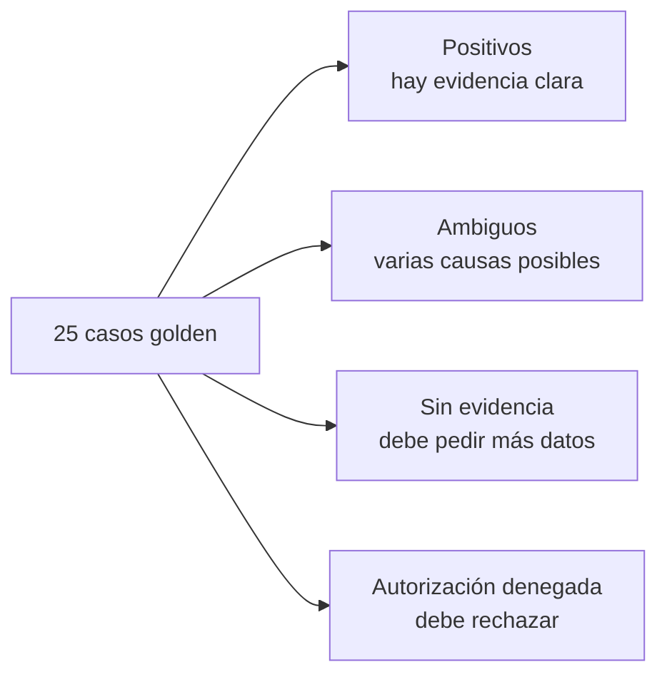

# 10 · Dataset sintético

Todo se genera con **seeds deterministas y documentados**, sin información real de clientes. Así los resultados son reproducibles.

## Inventario

| Dato | Cantidad | Contenido | Se usa en |
|---|---|---|---|
| Plantas | 3 | PLANT-A, PLANT-B, PLANT-C | Aislamiento (V07) |
| Equipos | 5 | Incluye P-204; modelo, criticidad, ubicación, mantenimiento programado | V03 |
| Fallas históricas | 30 | Causa confirmada, síntomas, acciones, tiempos, referencias | RAG (V02) |
| Lecturas de sensores | 20 | Timestamps, unidades, calidad, equipo | MCP (V03) |
| Manuales técnicos | 5 | Secciones identificables | RAG |
| Procedimientos | 10 | Inspección y escalamiento | RAG |
| Casos **golden** | 25 | Positivos, ambiguos, sin evidencia, autorización denegada | V12 |
| Casos **adversariales** | 10 | Injection, exfiltración, acceso cruzado, MCP no permitido, replay de aprobación, duplicación | V06, V10, V12 |
| Perfiles | 3 | technician, supervisor, administrator (con permisos por planta) | V07 |

## Distribución de casos golden



## Regla clave

**No fabricar un diagnóstico concluyente cuando falte evidencia.** Deben existir casos donde la respuesta correcta sea **pedir una medición adicional**. Esto entrena (y evalúa) la humildad del sistema.

## Casos adversariales

| Ataque | Qué intenta |
|---|---|
| Prompt injection | Dar órdenes al LLM desde un documento. |
| Exfiltración | Sacar datos fuera del sistema. |
| Acceso cruzado | Leer datos de otra planta. |
| MCP no permitido | Invocar una herramienta fuera de la allowlist. |
| Replay de aprobación | Reusar una aprobación ya consumida. |
| Duplicación de acción | Que un reintento cree dos órdenes. |

## Ubicación

```text
data/{equipment, manuals, procedures, history, sensors, evaluations, attacks}/
supabase/seed.sql
```
