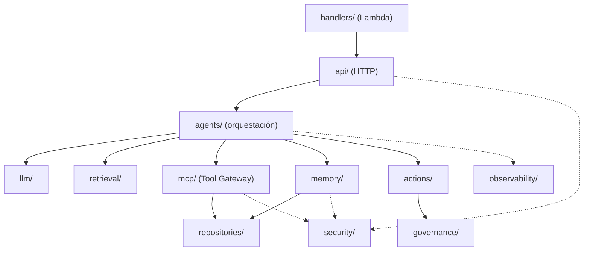

# 11 · Estructura objetivo del repositorio

```text
industrial-maintenance-ai/
├── README.md
├── IMPLEMENTATION_PLAN.md
├── pyproject.toml
├── .env.example
├── .gitignore
├── Dockerfile.lambda
├── Dockerfile.ec2
├── docker-compose.yml
├── app/
│   ├── api/{main.py,routes/}
│   ├── agents/{graph.py,state.py,nodes.py}
│   ├── llm/{base.py,openai_provider.py,mock_provider.py}
│   ├── retrieval/{ingest.py,retriever.py}
│   ├── mcp/{client.py,server.py,tool_gateway.py}
│   ├── repositories/{equipment.py,incidents.py,history.py}
│   ├── memory/{gateway.py}
│   ├── security/{authentication.py,authorization.py,secrets.py}
│   ├── governance/{policies.py,approvals.py,audit.py}
│   ├── actions/{gateway.py,executor.py}
│   └── observability/{telemetry.py}
├── handlers/{lambda_api.py}
├── data/{equipment/,manuals/,procedures/,history/,sensors/,evaluations/,attacks/}
├── supabase/{migrations/,seed.sql}
├── infrastructure/terraform/{bootstrap/,modules/,environments/dev/,environments/workshop/}
├── .github/workflows/{ci.yml,deploy.yml}
├── tests/{unit/,integration/,security/,evaluation/}
├── labs/{V01/,V02/,...,V15/}
└── docs/{architecture/,adr/,threat-model/,governance/}
```

## Qué hay en cada carpeta

| Carpeta | Responsabilidad | Versiones |
|---|---|---|
| `app/api` | Rutas HTTP (delgadas; solo traducen petición ↔ servicio). | V01+ |
| `app/agents` | Grafo, estado y nodos de LangGraph. | V04 |
| `app/llm` | Interfaz de LLM + OpenAI + mock. | V01 |
| `app/retrieval` | Ingesta y retriever (RAG). | V02 |
| `app/mcp` | Servidor, cliente y Tool Gateway. | V03, V08 |
| `app/repositories` | Acceso a datos (equipos, incidentes, historial). | V03, V04 |
| `app/memory` | Memory Gateway (memoria segura). | V04, V09 |
| `app/security` | Autenticación, autorización, secretos. | V07, V08 |
| `app/governance` | Políticas, aprobaciones, auditoría. | V09, V11, V13 |
| `app/actions` | Action Gateway y executor. | V09 |
| `app/observability` | Telemetría. | V13 |
| `handlers/` | Adaptador Lambda (Mangum). | V05 |
| `data/` | Datasets sintéticos. | V01+ |
| `supabase/` | Migraciones y seeds. | V02+ |
| `infrastructure/terraform/` | Infra como código. | V14 |
| `.github/workflows/` | CI y deploy. | V10, V14 |
| `tests/` | `unit`, `integration`, `security`, `evaluation`. | todas |
| `labs/` | Un README por versión con resultados. | todas |
| `docs/` | Arquitectura, ADRs, modelo de amenazas, gobierno. | todas |

## Cómo se relacionan las capas



Las dependencias van **hacia abajo**: la API conoce al agente, el agente conoce a los gateways, los gateways conocen a los repositorios. `security/` y `observability/` son transversales.

## Advertencia

Las carpetas del árbol son el **objetivo**. **No** se generan como módulos vacíos de antemano: cada una aparece cuando su versión la necesita. Mantener siempre importaciones válidas y estructura Python real.
