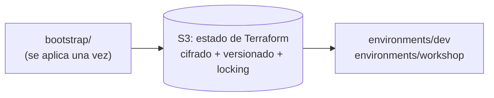
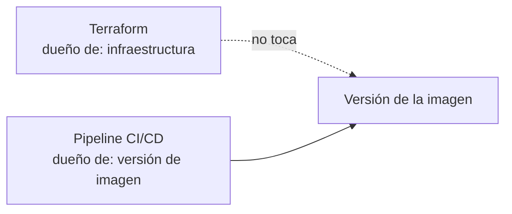

# 12 · Terraform y deployment

## Qué gestiona Terraform

| Recurso | Nota |
|---|---|
| IAM de mínimo privilegio | Roles de Lambda/EC2 con solo lo necesario. |
| API Gateway | Rutas explícitas. |
| Lambda | Desde imagen de ECR. |
| ECR | Registro de imágenes. |
| SQS / DLQ | Si aplica (acciones aprobadas). |
| Secrets Manager | Solo **metadatos**, **nunca los valores**. |
| CloudWatch | Logs, métricas, alarmas. |
| EC2 de demo | Con Docker. |

## Estado remoto (bootstrap separado)

El bootstrap va aparte porque crea el bucket que luego guarda el estado de todo lo demás (huevo y gallina).

## GitHub Actions

| Práctica | Detalle |
|---|---|
| Acceso a AWS | **OIDC**, sin access keys estáticas. |
| En cada PR | `terraform fmt`, `validate`, `plan`. |
| `terraform apply` | **Solo con aprobación.** |
| Imagen | Build reproducible + escaneo básico → ECR → despliegue **por digest**. |

## Despliegue por runtime

| Runtime | Cómo |
|---|---|
| **Lambda** | Imagen de **ECR** (GHCR no sirve para Lambda; es opcional solo como distribución). |
| **EC2** | Docker con *health checks*; documentar **actualización y rollback**. |

## Observabilidad en AWS

- Logs estructurados en CloudWatch.
- Métricas de errores y latencia; alarmas.
- Trazas **solo si hay exportador configurado**.

## Evitar drift: ¿quién es dueño de qué?

El CI/CD de aplicación **no** debe modificar atributos que Terraform controla. Se define explícitamente quién es dueño de la **versión de imagen** (el pipeline), para que Terraform no la revierta en su próximo `apply`.

## Recordatorio de seguridad operativa

⚠️ Ninguna acción de `apply`/`destroy` ni despliegue real sin **confirmación explícita** del operador.
