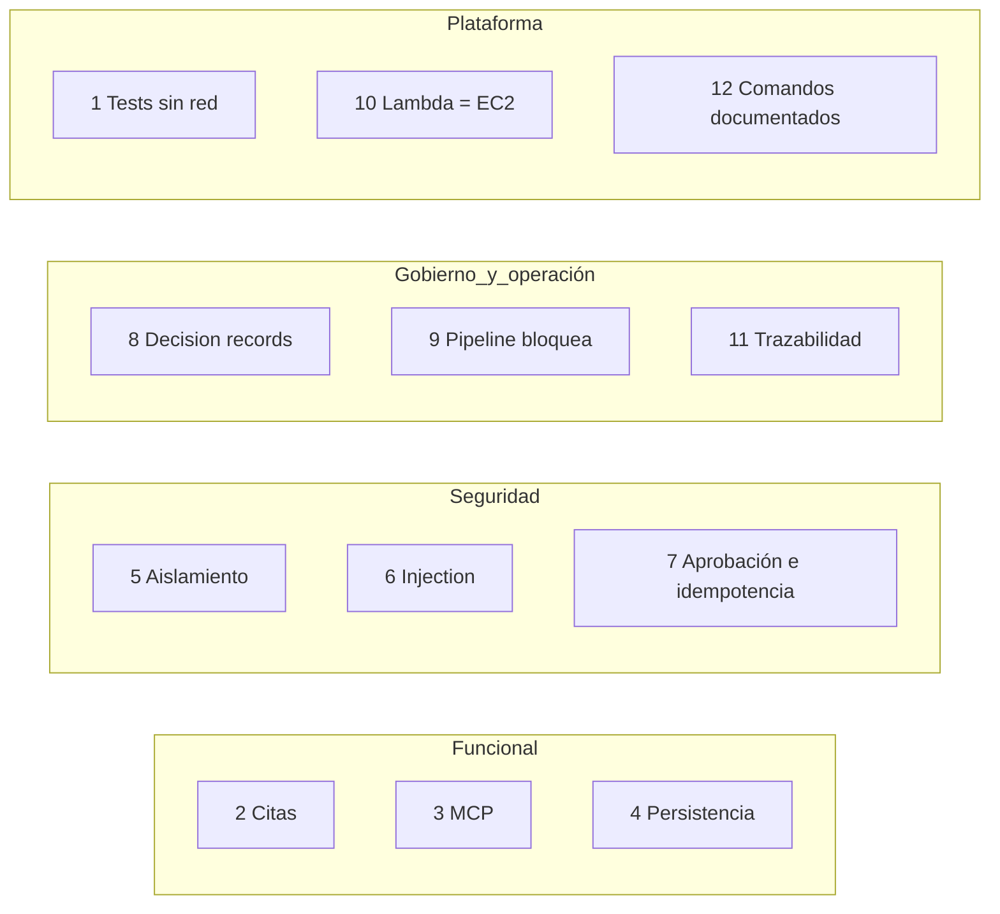

# 13 · Criterios globales de aceptación

El proyecto está "terminado" cuando se cumplen estos 12 puntos, **con pruebas que lo demuestren**.

| # | Criterio | Se demuestra con | Versión |
|---|---|---|---|
| 1 | `pytest` corre tests unitarios **sin red** en modo mock. | `pytest` offline | V01+ |
| 2 | Consulta a P-204 → respuesta estructurada **con citas** de historial. | Test de `/diagnose` | V02 |
| 3 | El agente usa **MCP** y **valida argumentos**. | Tests del Tool Gateway | V03 |
| 4 | El estado del incidente **persiste y se reanuda**. | Test sobre INC-204 | V04 |
| 5 | Usuario PLANT-A **no accede** a PLANT-B por **ninguna** ruta. | Tests de acceso (endpoint, RAG, memoria, MCP) | V07 |
| 6 | Prompt injection en historial **no provoca acción no autorizada**. | Tests adversariales | V06 |
| 7 | Orden sensible **requiere aprobación** y **no se duplica** por reintentos. | Tests de acciones | V09 |
| 8 | Cambios de políticas generan **decision records** auditables. | Test de políticas | V11 |
| 9 | El pipeline **bloquea** regresiones de seguridad y calidad. | CI con fallo inducido | V10, V14 |
| 10 | Lambda y EC2 ejecutan el **mismo núcleo** con pruebas comparables. | Test de paridad | V05 |
| 11 | Diagnósticos rastreables por `incident_id`, `run_id`, `trace_id`. | Test de correlación | V13 |
| 12 | Comandos de **setup, seed, test, build y deploy** documentados. | READMEs | todas |

## Cobertura por tema

## Regla de honestidad

No se declara un criterio cumplido sin **ejecutar su prueba**. Si no se puede ejecutar, se informa el bloqueo.
