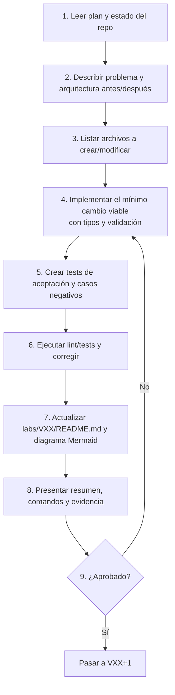

# 14 · Flujo de trabajo de Claude Code

## El ciclo por cada versión VXX



## Por qué cada paso

| Paso | Motivo |
|---|---|
| 1–3 | Entender antes de tocar; evitar sorpresas. |
| 4 | Cambios pequeños = revisión fácil. |
| 5 | Incluir **casos negativos**: lo prohibido debe fallar. |
| 6 | Verificar de verdad, no suponer. |
| 7 | Cada versión deja documentación reproducible. |
| 8 | Entrega con evidencia y riesgos. |
| 9 | Punto de control humano. |

## Qué debe incluir cada entrega

- Archivos modificados.
- Comandos para probar.
- Riesgos.
- Criterios pendientes.

## Prompt de arranque recomendado

> Lee `IMPLEMENTATION_PLAN.md`. Inspecciona el repositorio y crea un plan corto para V01. Implementa únicamente el scaffolding mínimo, el proveedor mock y OpenAI, `POST /diagnose`, modelos Pydantic, `.env.example`, tests unitarios y README. No despliegues recursos AWS ni implementes V02–V15 todavía. Ejecuta las pruebas y reporta resultados y próximos pasos.

## Plantilla sugerida para `labs/VXX/README.md`

```markdown
# VXX · Título
## Problema
## Arquitectura (antes → después, Mermaid)
## Archivos creados/modificados
## Cómo probar (comandos)
## Resultados (salida de pytest, latencias, etc.)
## Riesgos y criterios pendientes
```
