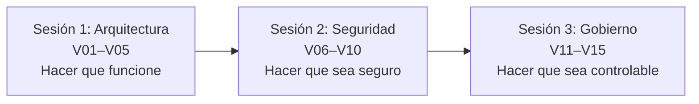
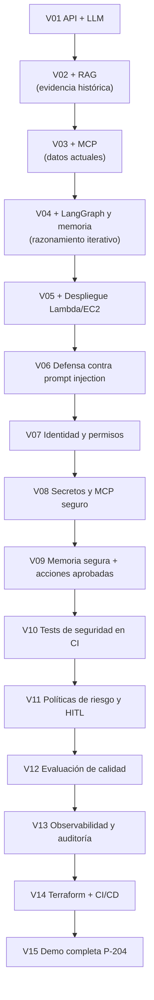

# Plan de implementación — Agente de IA para mantenimiento industrial

> Versión organizada por carpetas y explicada de `IMPLEMENTATION_PLAN.md`.
> El archivo original se conserva sin cambios; aquí está el mismo contenido repartido en archivos pequeños, con explicaciones adicionales.

## ¿Qué vamos a construir? (en 30 segundos)

Un **asistente de diagnóstico** para técnicos de planta. Un técnico dice: *"la bomba P-204 vibra mucho y está caliente, ¿qué pasa?"*. El sistema:

1. **Busca** en el historial de fallas parecidas (RAG).
2. **Consulta** datos actuales del equipo y sus sensores (herramientas MCP).
3. **Razona** paso a paso y propone hipótesis (LangGraph + LLM).
4. **Guarda** el incidente para retomarlo después (Supabase).
5. **Protege** todo: quién puede ver qué, qué puede hacer la IA y qué requiere aprobación humana.
6. **Mide** su calidad y deja **auditoría** de cada decisión.
7. **Se despliega** de forma reproducible (Docker, Terraform, GitHub Actions, AWS).

Todo con **datos sintéticos** y **sin tocar equipos reales**.

## Cómo está organizado el taller

Son **3 sesiones de 4 horas**, 15 versiones (V01–V15). Cada versión añade una capacidad sobre la anterior.

| Sesión | Tema | Pregunta que responde | Versiones |
|---|---|---|---|
| 1 | AI Architecture | ¿Cómo construyo un agente que funcione? | V01–V05 |
| 2 | AI Security | ¿Cómo evito que lo engañen o abusen de él? | V06–V10 |
| 3 | AI Governance | ¿Cómo lo controlo, mido y audito? | V11–V15 |



## Mapa de carpetas

```text
implementation_plan/
├── README.md                          ← estás aquí (índice y guía de lectura)
├── 00-glosario.md                     ← términos técnicos explicados en simple
├── 01-instrucciones-claude-code.md    ← reglas de trabajo para el asistente de código
├── 02-objetivos-y-alcance.md          ← qué sí y qué NO hace el sistema; datos del caso P-204
├── 03-stack-y-decisiones.md           ← tecnologías elegidas y por qué
├── 04-arquitectura/
│   ├── 01-arquitectura-objetivo.md    ← diagrama general y cómo leerlo
│   └── 02-lambda-vs-ec2.md            ← dónde se ejecuta y por qué
├── 05-sesion-1-architecture/
│   ├── README.md                      ← resumen de la sesión y tiempos
│   ├── V01-fastapi-openai.md
│   ├── V02-rag-supabase.md
│   ├── V03-mcp-tools.md
│   ├── V04-langgraph-memoria.md
│   └── V05-lambda-vs-ec2.md
├── 06-sesion-2-security/
│   ├── README.md
│   ├── V06-prompt-injection.md
│   ├── V07-jwt-rbac-abac.md
│   ├── V08-secrets-mcp-seguro.md
│   ├── V09-memoria-segura-acciones.md
│   └── V10-security-ci.md
├── 07-sesion-3-governance/
│   ├── README.md
│   ├── V11-politicas-riesgo-hitl.md
│   ├── V12-evaluacion.md
│   ├── V13-observabilidad-auditoria.md
│   ├── V14-terraform-cicd.md
│   └── V15-end-to-end-p204.md
├── 08-contratos-api.md                ← endpoints y formato de peticiones/respuestas
├── 09-esquema-datos.md                ← tablas de Supabase y relaciones
├── 10-dataset-sintetico.md            ← qué datos de prueba se generan
├── 11-estructura-repositorio.md       ← árbol de carpetas del código final
├── 12-terraform-y-deployment.md       ← infraestructura y despliegue
├── 13-criterios-aceptacion.md         ← cuándo está "terminado" el proyecto
└── 14-flujo-de-trabajo.md             ← ciclo de trabajo por versión
```

## Orden de lectura sugerido

- **Quiero entender la idea general:** `00-glosario` → `02-objetivos-y-alcance` → `04-arquitectura/01`.
- **Voy a implementar:** `01-instrucciones` → `14-flujo-de-trabajo` → la versión que toque.
- **Me interesa la seguridad:** `06-sesion-2-security/` completa + `09-esquema-datos`.
- **Me interesa desplegar:** `04-arquitectura/02` → `V05` → `V14` → `12-terraform-y-deployment`.

## Cómo cada versión se apoya en la anterior



**Regla de oro:** se implementa **una versión por vez**, se prueba, y se espera aprobación antes de continuar.
