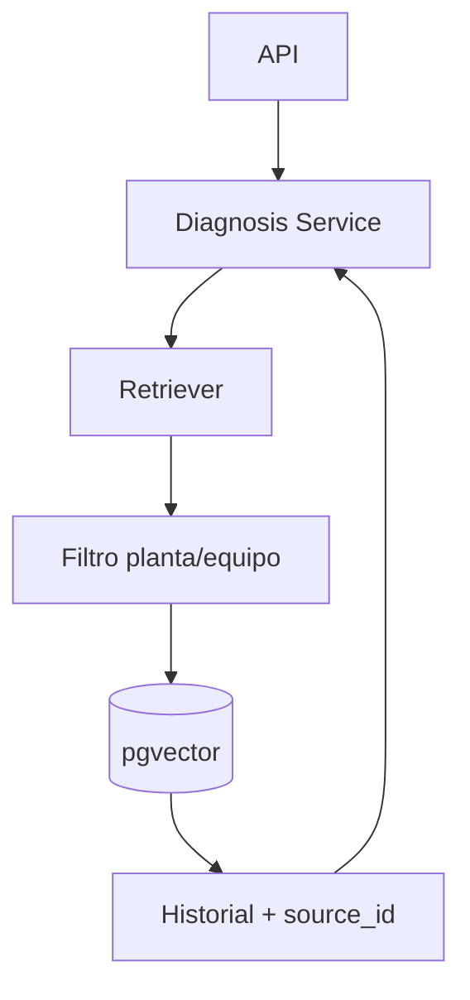

# V02 — RAG con Supabase pgvector

**Problema:** El LLM no tiene evidencia histórica.

## Arquitectura



## Archivos principales

app/retrieval/{ingest,retriever}.py, app/llm/embeddings.py, scripts/ingest.py, supabase/migrations/

## Cómo probar (modo mock, sin red)

```bash
.venv/bin/python -m pytest tests/unit/test_v02_rag.py -v
```

## Aceptación

Recupera fallas de bombas con `source_id`, nunca otras plantas, descarta citas inventadas por el LLM, sin evidencia → pide más datos.

## Riesgos / pendientes

- Datos y valores sintéticos; no son límites de seguridad industrial.
- Modo real (OpenAI / Supabase / AWS) requiere configuración en `.env.example`; no verificado en este README.
