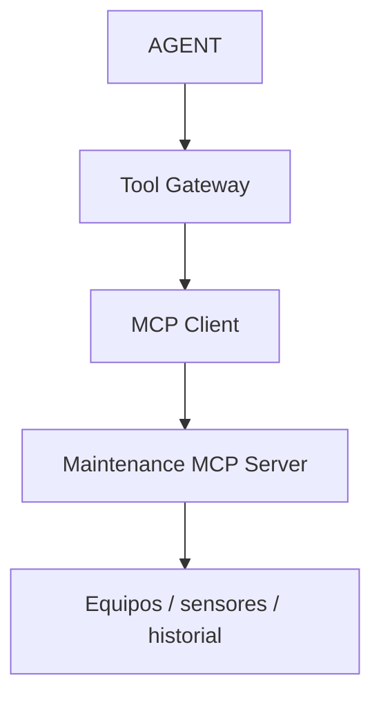

# V03 — MCP tools

**Problema:** RAG no da mediciones actuales.

## Arquitectura



## Archivos principales

app/mcp/{server,client,tool_gateway,schemas}.py

## Cómo probar (modo mock, sin red)

```bash
.venv/bin/python -m pytest tests/unit/test_v03_tools.py -v
```

## Aceptación

Descubrimiento de 3 herramientas, resultados tipados, argumentos inválidos y herramientas inexistentes rechazados.

## Riesgos / pendientes

- Datos y valores sintéticos; no son límites de seguridad industrial.
- Modo real (OpenAI / Supabase / AWS) requiere configuración en `.env.example`; no verificado en este README.
