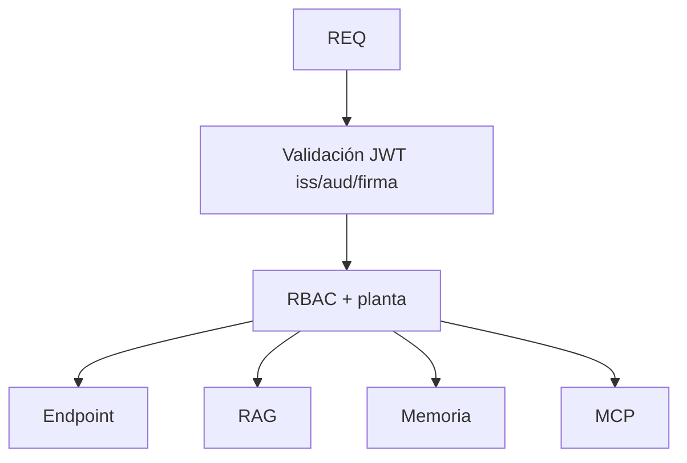

# V07 — JWT + RBAC/ABAC

**Problema:** Aislamiento por planta en todas las rutas.

## Arquitectura



## Archivos principales

app/security/{authentication,authorization}.py, app/api/deps.py, supabase/migrations/ (RLS)

## Cómo probar (modo mock, sin red)

```bash
.venv/bin/python -m pytest tests/security/test_v07_access_control.py -v
```

## Aceptación

PLANT-A no accede a PLANT-B por endpoint, RAG, memoria ni MCP. La API key de API Gateway no sustituye al JWT.

## Riesgos / pendientes

- Datos y valores sintéticos; no son límites de seguridad industrial.
- Modo real (OpenAI / Supabase / AWS) requiere configuración en `.env.example`; no verificado en este README.
