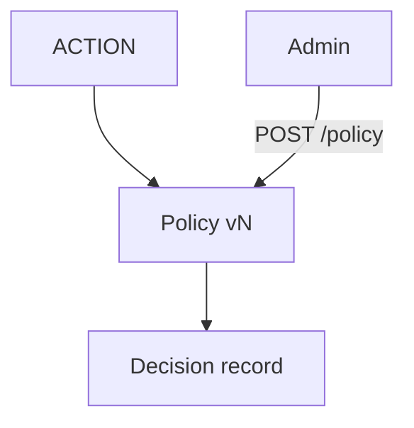

# V11 — Política de riesgo y HITL

**Problema:** Decisiones de riesgo versionadas y auditables.

## Arquitectura



## Archivos principales

app/governance/policies.py, app/api/routes/admin.py

## Cómo probar (modo mock, sin red)

```bash
.venv/bin/python -m pytest tests/unit/test_v11_policies.py -v
```

## Aceptación

Consultas y borradores permitidos; publicar requiere aprobación; control de PLC siempre prohibido (ninguna política puede relajarlo).

## Riesgos / pendientes

- Datos y valores sintéticos; no son límites de seguridad industrial.
- Modo real (OpenAI / Supabase / AWS) requiere configuración en `.env.example`; no verificado en este README.
