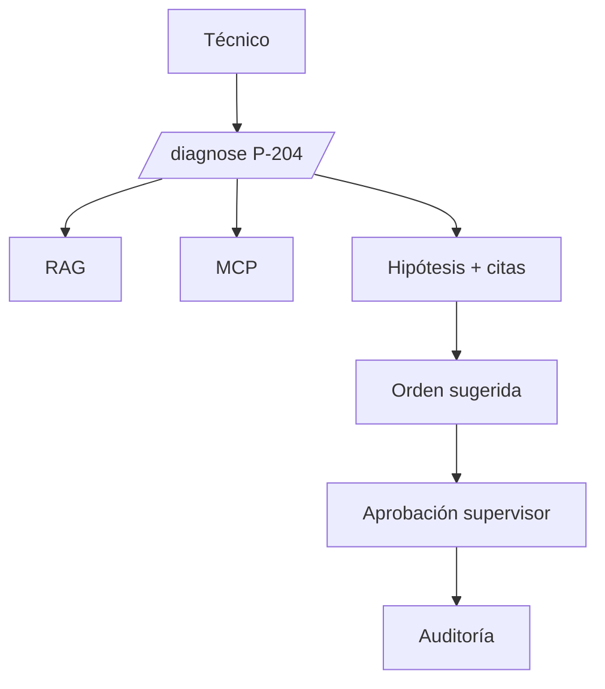

# V15 — End-to-end P-204

**Problema:** Integrar todo el caso del workshop.

## Arquitectura



## Archivos principales

tests/integration/test_v15_end_to_end_p204.py

## Cómo probar (modo mock, sin red)

```bash
.venv/bin/python -m pytest tests/integration/test_v15_end_to_end_p204.py -v
```

## Aceptación

Caso completo con datos sintéticos (86 °C, 8.4 mm/s, 2.8 bar, INC-204); valores ficticios, no son límites de seguridad.

## Riesgos / pendientes

- Datos y valores sintéticos; no son límites de seguridad industrial.
- Modo real (OpenAI / Supabase / AWS) requiere configuración en `.env.example`; no verificado en este README.
